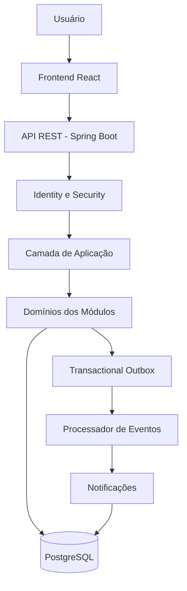
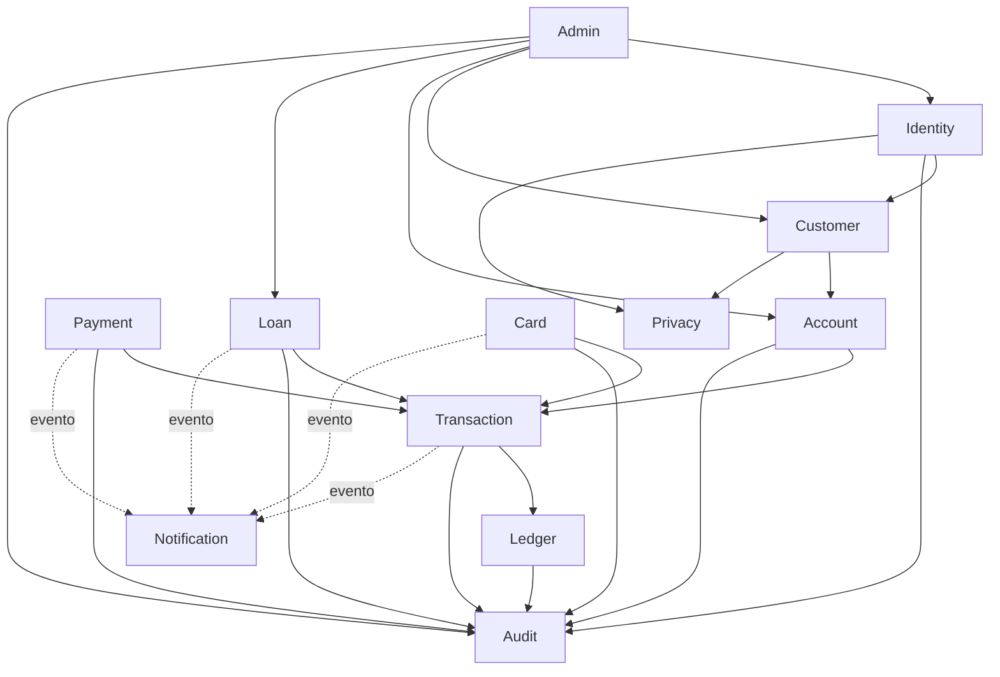
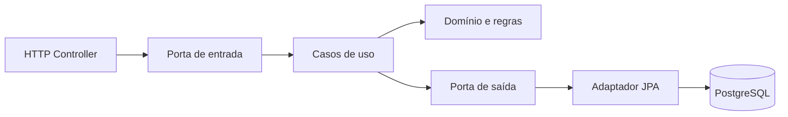
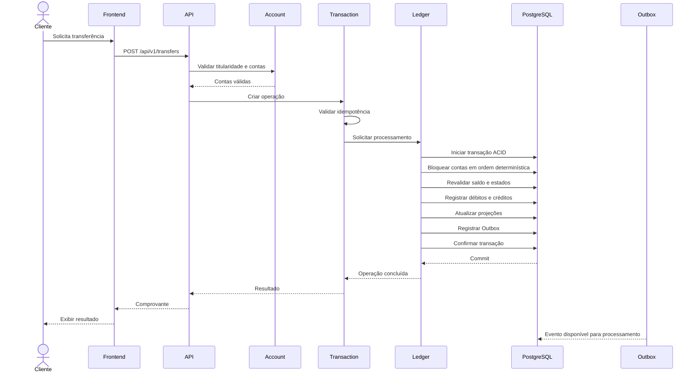
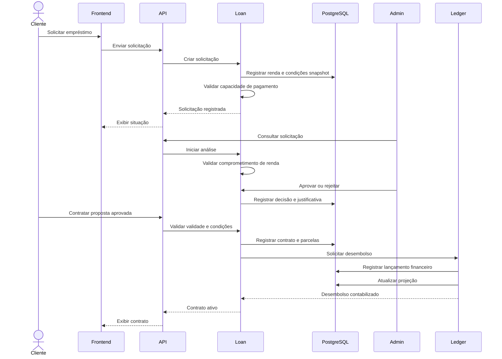
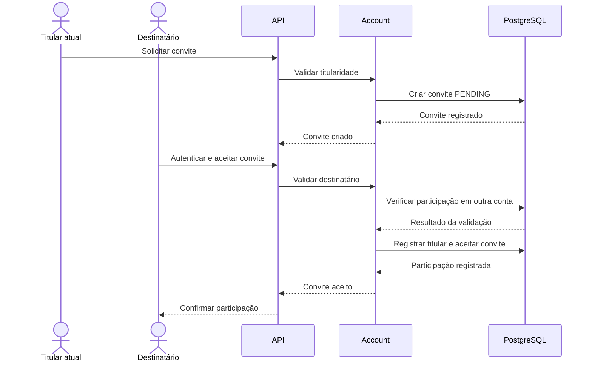
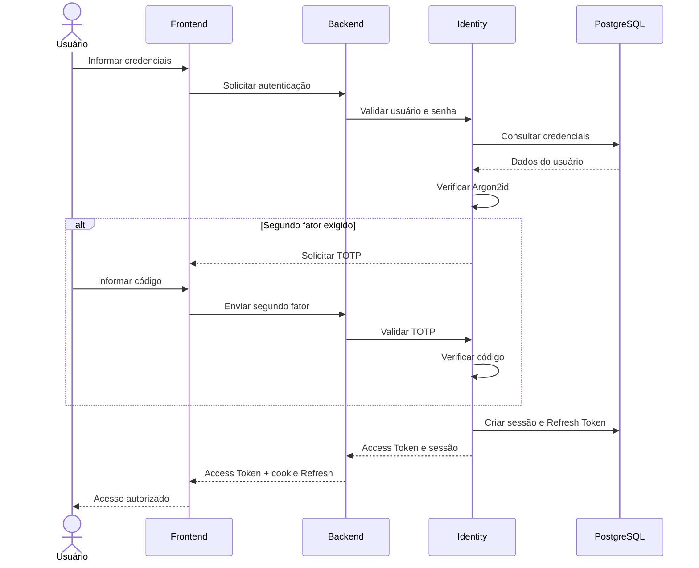
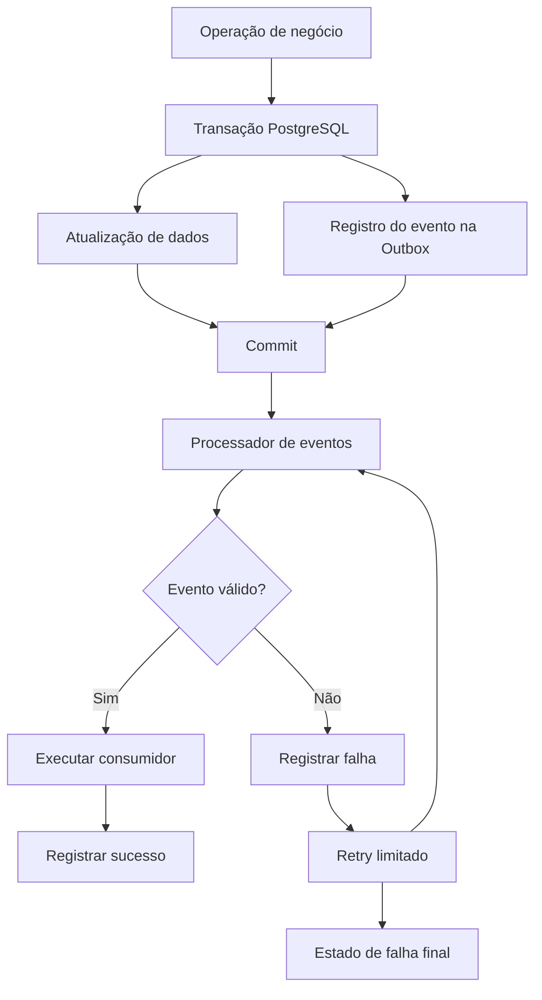
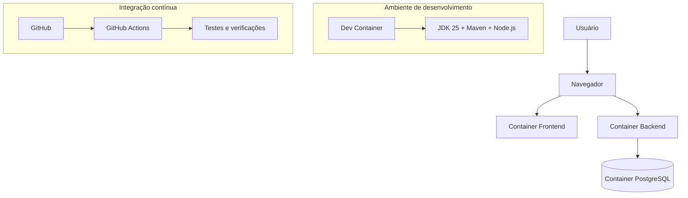
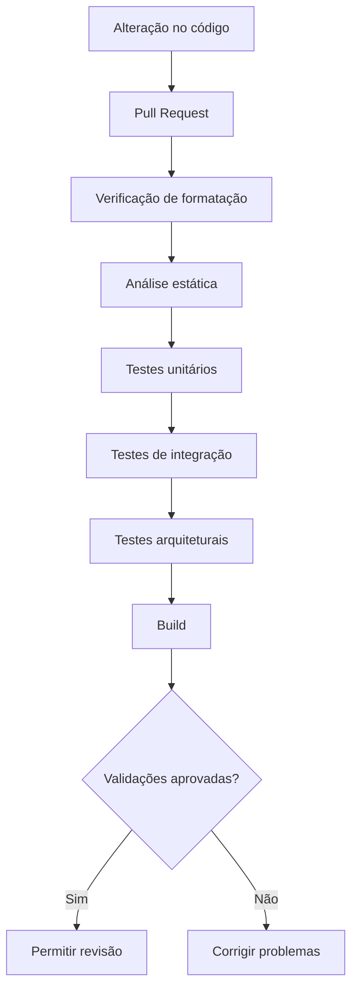

# MyBank — Arquitetura e Diagramas

| Campo | Valor |
| --- | --- |
| Identificador | MB-ARCH-001 |
| Classe | Documento oficial da biblioteca MyBank |
| Original preservado | [MyBank — Arquitetura e Diagramas.md](../99-fontes-originais/MyBank%20—%20Arquitetura%20e%20Diagramas.md) |
| Versão | 1.0 — Proposta para aprovação |
| Arquitetura | Hexagonal + Monólito Modular |
| Backend | Java 25 LTS + Spring Boot |
| Frontend | React + JavaScript |
| Banco de dados | PostgreSQL |

## Sumário

- [1. Visão arquitetural](#1-visao-arquitetural)
- [1.1. Objetivo](#11-objetivo)
- [1.2. Decisões fundamentais](#12-decisoes-fundamentais)
- [1.3. Visão geral da arquitetura](#13-visao-geral-da-arquitetura)
- [2. Organização modular](#2-organizacao-modular)
- [2.1. Módulos do backend](#21-modulos-do-backend)
- [2.2. Diagrama de módulos](#22-diagrama-de-modulos)
- [2.3. Regras de dependência](#23-regras-de-dependencia)
- [3. Arquitetura Hexagonal interna](#3-arquitetura-hexagonal-interna)
- [3.1. Estrutura conceitual](#31-estrutura-conceitual)
- [3.2. Diagrama Hexagonal](#32-diagrama-hexagonal)
- [4. Fluxo de transferência financeira](#4-fluxo-de-transferencia-financeira)
- [4.1. Objetivo](#41-objetivo)
- [4.2. Componentes envolvidos](#42-componentes-envolvidos)
- [4.3. Diagrama de sequência](#43-diagrama-de-sequencia)
- [5. Fluxo de empréstimos](#5-fluxo-de-emprestimos)
- [5.1. Componentes envolvidos](#51-componentes-envolvidos)
- [5.2. Diagrama de sequência](#52-diagrama-de-sequencia)
- [6. Fluxo de conta conjunta](#6-fluxo-de-conta-conjunta)
- [6.1. Diagrama de sequência](#61-diagrama-de-sequencia)
- [7. Arquitetura de segurança](#7-arquitetura-de-seguranca)
- [7.1. Componentes](#71-componentes)
- [7.2. Diagrama de autenticação](#72-diagrama-de-autenticacao)
- [8. Arquitetura de eventos](#8-arquitetura-de-eventos)
- [8.1. Objetivo](#81-objetivo)
- [8.2. Fluxo da Outbox](#82-fluxo-da-outbox)
- [9. Arquitetura de implantação](#9-arquitetura-de-implantacao)
- [9.1. Desenvolvimento](#91-desenvolvimento)
- [9.2. Produção simulada](#92-producao-simulada)
- [9.3. Diagrama de implantação](#93-diagrama-de-implantacao)
- [10. Fluxo de qualidade e integração contínua](#10-fluxo-de-qualidade-e-integracao-continua)
- [10.1. Pipeline](#101-pipeline)
- [11. Observabilidade e auditoria](#11-observabilidade-e-auditoria)
- [12. Limites arquiteturais](#12-limites-arquiteturais)
- [13. Pendências para detalhamento posterior](#13-pendencias-para-detalhamento-posterior)
- [14. Decisões complementares aprovadas](#14-decisoes-complementares-aprovadas)

## 1. Visão arquitetural

## 1.1. Objetivo

Definir a organização estrutural do MyBank, seus módulos, responsabilidades, dependências, fluxos de comunicação e infraestrutura.

A arquitetura deverá garantir:

- Separação entre regras de negócio e tecnologias.
- Independência do domínio.
- Consistência financeira.
- Segurança.
- Testabilidade.
- Baixo acoplamento.
- Evolução modular.
- Simplicidade operacional.

## 1.2. Decisões fundamentais

| Aspecto | Decisão |
| --- | --- |
| Estilo arquitetural | Hexagonal |
| Organização | Monólito Modular |
| Backend | Java + Spring Boot |
| Frontend | React |
| Persistência | PostgreSQL |
| ORM | Spring Data JPA |
| Migrações | Flyway |
| Comunicação externa | REST |
| Documentação API | OpenAPI 3.1.1 |
| Comunicação interna | Síncrona e assíncrona |
| Eventos | Transactional Outbox |
| Mensageria externa | Não utilizar na primeira versão |

## 1.3. Visão geral da arquitetura

O frontend realiza requisições HTTP para a API REST.

O backend recebe as requisições e encaminha a execução aos casos de uso dos módulos correspondentes.

Cada módulo mantém suas próprias regras de domínio e responsabilidades.

O PostgreSQL armazena os dados do sistema, incluindo as informações financeiras, os lançamentos do Ledger, auditoria e eventos pendentes da Outbox.

## 2. Organização modular

## 2.1. Módulos do backend

O backend será dividido em doze módulos principais.

| Módulo | Responsabilidade |
| --- | --- |
| Identity | Usuários, autenticação, tokens e sessões |
| Customer | Cadastro e perfil dos clientes |
| Account | Contas bancárias e titulares |
| Transaction | Operações financeiras |
| Ledger | Contabilidade e saldos |
| Payment | Pagamentos fictícios |
| Loan | Empréstimos e parcelas |
| Card | Cartões virtuais |
| Notification | Notificações e entregas |
| Admin | Operações administrativas |
| Audit | Auditoria e rastreabilidade |
| Privacy | Privacidade e retenção |

## 2.2. Diagrama de módulos

**Observação:** o diagrama representa relacionamentos funcionais, não autorização para acesso direto às estruturas internas de outros módulos.

As dependências deverão ser implementadas por contratos explícitos, serviços de aplicação ou eventos, conforme a necessidade.

## 2.3. Regras de dependência

1. O domínio não deve depender de Spring, JPA ou infraestrutura.
2. A camada de aplicação coordena os casos de uso.
3. Adaptadores de infraestrutura implementam os contratos necessários.
4. Controllers REST não devem conter regras de negócio.
5. Módulos não devem acessar repositórios internos de outros módulos diretamente.
6. Dependências entre módulos devem ser explícitas.
7. O módulo Ledger deve preservar sua independência e suas invariantes financeiras.
8. Eventos assíncronos não devem substituir operações financeiras síncronas.

## 3. Arquitetura Hexagonal interna

## 3.1. Estrutura conceitual

Cada módulo deverá separar:

**Domain**
- Entidades.
- Objetos de valor.
- Regras de negócio.
- Serviços de domínio quando necessários.
- Eventos de domínio.

**Application**
- Casos de uso.
- Coordenação de operações.
- Portas de entrada e saída quando justificadas.
- Transações de aplicação.

**Infrastructure**
- Controllers REST.
- Repositórios JPA.
- Adaptadores de persistência.
- Configurações.
- Integrações técnicas.
- Implementações de segurança.

## 3.2. Diagrama Hexagonal

A direção das dependências deve preservar o domínio como núcleo independente.

Os detalhes de implementação deverão ser definidos no momento da criação dos módulos, sem interfaces desnecessárias.

## 4. Fluxo de transferência financeira

## 4.1. Objetivo

Demonstrar como uma transferência interna deverá ser processada mantendo consistência e rastreabilidade.

## 4.2. Componentes envolvidos

- Identity.
- Account.
- Transaction.
- Ledger.
- Audit.
- Notification.

## 4.3. Diagrama de sequência

### Regras importantes

- Toda operação deverá possuir chave de idempotência.
- A validação de saldo deverá ocorrer dentro do processamento transacional.
- Os bloqueios deverão seguir ordem determinística.
- Débitos e créditos deverão ser registrados na mesma transação.
- A projeção deverá ser atualizada atomicamente.
- Falhas não poderão deixar movimentações parciais contabilizadas.
- Notificações serão processadas separadamente.

## 5. Fluxo de empréstimos

## 5.1. Componentes envolvidos

- Customer.
- Loan.
- Account.
- Transaction.
- Ledger.
- Admin.
- Audit.
- Notification.

## 5.2. Diagrama de sequência

### Regras importantes

- A renda utilizada será a registrada no snapshot.
- O comprometimento máximo será de 30%.
- A aprovação deverá possuir justificativa.
- A proposta aprovada terá validade.
- O desembolso deverá ser atômico.
- O contrato deverá preservar as condições aprovadas.
- A contratação não poderá gerar movimentação duplicada.

## 6. Fluxo de conta conjunta

## 6.1. Diagrama de sequência

### Regras importantes

- O destinatário deve estar autenticado.
- Somente o destinatário poderá aceitar.
- O backend deverá validar a participação em outra conta.
- A operação deverá respeitar a concorrência.
- O convite deverá possuir validade.
- O histórico deverá ser preservado.

## 7. Arquitetura de segurança

## 7.1. Componentes

- Frontend React.
- Spring Security.
- Autenticação JWT.
- Refresh Token em cookie protegido.
- Argon2id.
- TOTP.
- AES-256-GCM.
- Controle de autorização.
- Auditoria.

## 7.2. Diagrama de autenticação

### Regras de segurança

- Access Token mantido em memória.
- Refresh Token em cookie HttpOnly, Secure e SameSite.
- Proteção CSRF conforme estratégia de cookies.
- Rotação de Refresh Token.
- Revogação de sessões.
- Detecção de reutilização.
- ADMIN precisa configurar TOTP antes de acessar o painel.
- CUSTOMER utiliza TOTP opcionalmente.
- Toda operação protegida deve validar autorização no backend.

## 8. Arquitetura de eventos

## 8.1. Objetivo

Permitir processamento assíncrono de tarefas secundárias sem comprometer a consistência das operações financeiras.

## 8.2. Fluxo da Outbox

### Regras

- Evento e operação de negócio deverão ser persistidos na mesma transação quando aplicável.
- O processador deverá tolerar duplicidade.
- Eventos terão identificadores únicos.
- Haverá tentativas limitadas.
- Falhas deverão ser registradas.
- Eventos não deverão gerar movimentações financeiras duplicadas.
- A Outbox deverá permitir rastreabilidade e recuperação de eventos.

Não será introduzido broker externo na primeira versão.

## 9. Arquitetura de implantação

## 9.1. Desenvolvimento

O ambiente de desenvolvimento utilizará:

- Dev Containers.
- JDK 25.
- Maven Wrapper.
- Node.js LTS.
- npm.
- Docker Compose.
- PostgreSQL.

O frontend e backend poderão ser executados em modo de desenvolvimento com suporte a recarga automática.

## 9.2. Produção simulada

A produção simulada utilizará aplicações empacotadas em containers, com PostgreSQL e configurações externas.

## 9.3. Diagrama de implantação

### Regras

- Segredos não devem ser incorporados às imagens.
- `.env` não deve ser versionado.
- PostgreSQL deverá possuir persistência em volume.
- As aplicações deverão possuir configuração por ambiente.
- A inicialização deverá ser documentada.
- A infraestrutura não deverá depender de ferramentas globais desnecessárias.

## 10. Fluxo de qualidade e integração contínua

## 10.1. Pipeline

A execução do pipeline não substitui a revisão humana nem a aprovação de cada etapa.

## 11. Observabilidade e auditoria

A arquitetura deverá permitir:

- Logs estruturados.
- Identificação de requisições.
- Rastreamento de erros.
- Histórico de operações.
- Registro de ações administrativas.
- Monitoramento de eventos pendentes.
- Monitoramento de falhas de processamento.
- Diagnóstico de operações financeiras.

Utilizar SLF4J e Logback.

Não registrar senhas, tokens, segredos ou dados sensíveis desnecessários.

## 12. Limites arquiteturais

As seguintes restrições são obrigatórias:

1. Não implementar microsserviços na primeira versão.
2. Não introduzir Kafka ou RabbitMQ.
3. Não colocar regras financeiras no frontend.
4. Não permitir acesso direto ao banco pelo frontend.
5. Não permitir alteração direta de saldo.
6. Não tornar a projeção de saldo fonte oficial.
7. Não utilizar eventos assíncronos para substituir a consistência do Ledger.
8. Não permitir dependências circulares entre módulos.
9. Não misturar domínio com infraestrutura.
10. Não criar abstrações sem necessidade concreta.

## 13. Pendências para detalhamento posterior

Os diagramas representam a arquitetura aprovada em nível conceitual. Antes da implementação, ainda será necessário detalhar:

- Estados e transições de contas e clientes.
- Fluxo de encerramento de contas com empréstimos ativos.
- Fluxo de pagamento das parcelas após encerramento da conta.
- Regras detalhadas de estornos administrativos.
- Política de autorização por endpoint.
- Estratégia específica de CSRF para o cookie de Refresh Token.
- Estratégia de recuperação de eventos que excederem o limite de tentativas.
- Topologia definitiva dos containers.
- Estratégia de exposição e configuração dos serviços por ambiente.

Esses detalhes deverão ser documentados sem contradizer as decisões já aprovadas.

## 14. Decisões complementares aprovadas

O módulo responsável por dados de clientes deverá aplicar AES-256-GCM ao CPF armazenado e HMAC-SHA-256 independente para pesquisa e unicidade. As chaves permanecem fora do banco e do código-fonte; versões de chave e rotação devem preservar a capacidade de localizar e verificar registros existentes. Logs não podem conter CPF, ciphertext ou HMAC do CPF.

A Outbox mantém o conteúdo original e o histórico das tentativas. `FAILED` é o estado terminal oficial e o único elegível a reprocessamento, sujeito às demais verificações. `DEAD_LETTER` é apenas o encaminhamento ou armazenamento operacional de eventos esgotados, sem constituir estado alternativo. O reprocessamento é uma operação administrativa rastreável, com autorização, 2FA, reautenticação, justificativa, confirmação, idempotência e controle de concorrência. O endpoint é `POST /api/v1/admin/outbox-events/{eventId}/reprocess`; a aceitação é assíncrona (`202 Accepted`) e devolve `statusUrl` para consulta.
