# MyBank — DER e Dicionário de Dados

| Campo | Valor |
|---|---|
| Identificador | MB-DATA-001 |
| Classe | Documento oficial da biblioteca MyBank |
| Versão | 1.1 — Consolidação documental |
| Estado | Versão 1.1 aprovada; resolução documental das pendências desta etapa aguarda aprovação humana |
| Banco | PostgreSQL |
| Origem preservada | [Documento de modelagem v1.0 — proposta para revisão](../99-fontes-originais/MyBank%20—%20Documento%20de%20Modelagem%20do%20Banco%20de%20Dados.md) |
| Complemento | [Revisão da modelagem e pendências](revisao-modelagem-e-pendencias.md), proposta usada somente quando confirmada por decisões posteriores |

## Sumário

- [1. Objetivo e convenções](#1-objetivo-e-convencoes)
- [2. Autoridade e status das definições](#2-autoridade-e-status-das-definicoes)
- [3. Diagrama Entidade-Relacionamento](#3-diagrama-entidade-relacionamento)
- [4. Dicionário de dados](#4-dicionario-de-dados)
- [4.12. Estruturas adicionais aprovadas](#412-estruturas-adicionais-aprovadas)
- [5. Restrições e integridade](#5-restricoes-e-integridade)
- [6. Estados](#6-estados)
- [7. Consistência financeira](#7-consistencia-financeira)
- [8. Segurança, privacidade e preservação](#8-seguranca-privacidade-e-preservacao)
- [9. Organização por módulos](#9-organizacao-por-modulos)
- [10. Pendências técnicas](#10-pendencias-tecnicas)
- [11. Rastreabilidade e critérios de revisão](#11-rastreabilidade-e-criterios-de-revisao)

## 1. Objetivo e convenções

### Objetivo da modelagem

Definir a estrutura de persistência do MyBank, contemplando:

- Identidade, autenticação e segurança.
- Clientes, contas individuais e conjuntas.
- Titularidade, convites e encerramento de contas.
- Transações financeiras e histórico de estados.
- Ledger contábil com partidas dobradas.
- Depósitos, saques e transferências.
- Pagamentos simulados.
- Empréstimos e parcelas.
- Cartões virtuais.
- Notificações.
- Administração e auditoria.
- Privacidade, retenção e solicitações LGPD.
- Processamento assíncrono por eventos.

O banco deverá preservar a integridade financeira, rastreabilidade, consistência transacional e histórico das operações.

## Convenções gerais

### Tipos de dados

| Tipo | Utilização |
|---|---|
| `UUID` | Identificadores primários e relacionamentos |
| `VARCHAR(n)` | Textos com tamanho definido |
| `TEXT` | Textos extensos |
| `NUMERIC(19,2)` | Valores monetários em BRL |
| `NUMERIC(9,6)` | Taxas de juros |
| `NUMERIC(5,2)` | Percentuais de participação |
| `INTEGER` | Quantidades e contadores |
| `BOOLEAN` | Indicadores lógicos |
| `DATE` | Datas sem horário |
| `TIMESTAMPTZ` | Datas e horários com fuso |
| `JSONB` | Metadados estruturados e configurações flexíveis |

### Convenções de nomenclatura

- Tabelas no plural e em `snake_case`.
- Colunas em `snake_case`.
- Chaves primárias com o nome `id`.
- Chaves estrangeiras identificadas pelo nome da entidade relacionada, seguido de `_id`.
- Datas de criação e atualização com `created_at` e `updated_at`, quando aplicáveis.
- Datas de exclusão lógica não serão adicionadas indiscriminadamente.
- Estados serão armazenados como valores controlados, preferencialmente com restrições `CHECK` ou tabelas de domínio quando houver necessidade de configuração.

### Regras monetárias

- Todos os valores financeiros serão armazenados em `NUMERIC(19,2)`.
- No Java, será utilizado `BigDecimal`.
- Não utilizar `float` ou `double` para operações financeiras.
- A moeda será exclusivamente BRL.
- Não haverá tabelas de câmbio, moedas adicionais ou conversões.
- Valores de taxas e percentuais terão precisão própria, sem serem confundidos com valores monetários.

# 2. Autoridade e status das definições

As decisões aceitas nos ADRs e nas decisões técnicas complementares são normativas. Decisões posteriores explicitamente aprovadas prevalecem sobre anotações antigas de pendência. A aprovação da etapa OpenAPI confirma o contrato daquela etapa, mas não aprova integralmente esta modelagem.

A especificação funcional, a arquitetura, os contratos REST e os fluxos contêm trechos identificados como proposta. Eles são usados como referência somente quando corroboram decisão aprovada ou quando o contrato OpenAPI aceito fornece a definição correspondente. Propostas físicas da revisão de modelagem não são convertidas automaticamente em decisões.

As 38 entidades e atributos da versão 1.0 são preservados como base documental, exceto onde substituídos por requisito aprovado. Definições originais não confirmadas continuam sendo propostas, não decisões normativas. Quatro estruturas lógicas aprovadas são acrescentadas. Campos ainda sem definição física são nomeados como pendência, não como esquema definitivo.

Este arquivo é uma consolidação documental para revisão. Não contém SQL, migrações nem autorização de implementação. O documento original v1.0 permanece intacto em `docs/99-fontes-originais/`.

# 3. Diagrama Entidade-Relacionamento

Diagramas separados por módulo. Toda relação corresponde a uma FK do dicionário ou a uma associação lógica aprovada cuja forma física permanece explicitamente pendente. Cada entidade tem uma definição no módulo proprietário; referências a outros módulos são endpoints de relação.

### 3.1. Identity e Customer

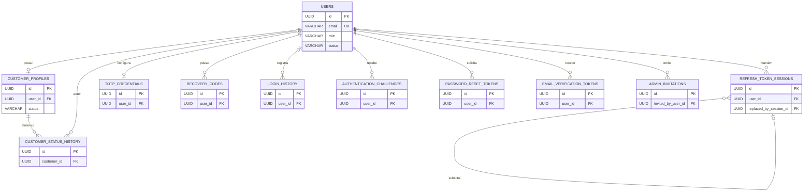

A relação autorreferente representa `replaced_by_session_id`. `ADMIN_INVITATIONS` relaciona o emissor; o destinatário é identificado pelo e-mail do convite.

### 3.2. Account

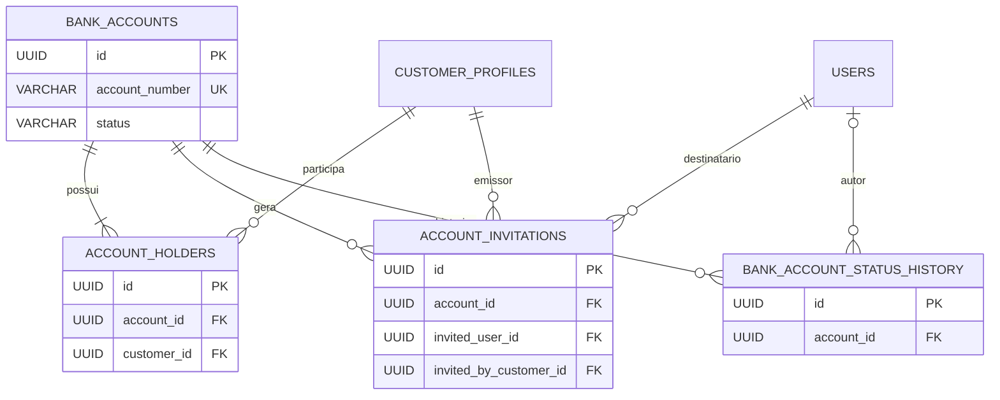

### 3.3. Transaction

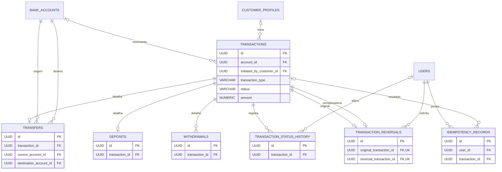

As relações de `TRANSACTION_REVERSALS` distinguem transação original e compensatória. Cada FK é única, conforme regra aprovada. `withdrawals.transaction_id` não está declarado único no dicionário-base; por isso o diagrama representa zero ou muitos detalhes por transação, refletindo a nulabilidade/uniquidade documentada sem acrescentar uma constraint. A transação em `IDEMPOTENCY_RECORDS` é opcional; o resultado da operação é preservado no registro idempotente.

### 3.4. Ledger

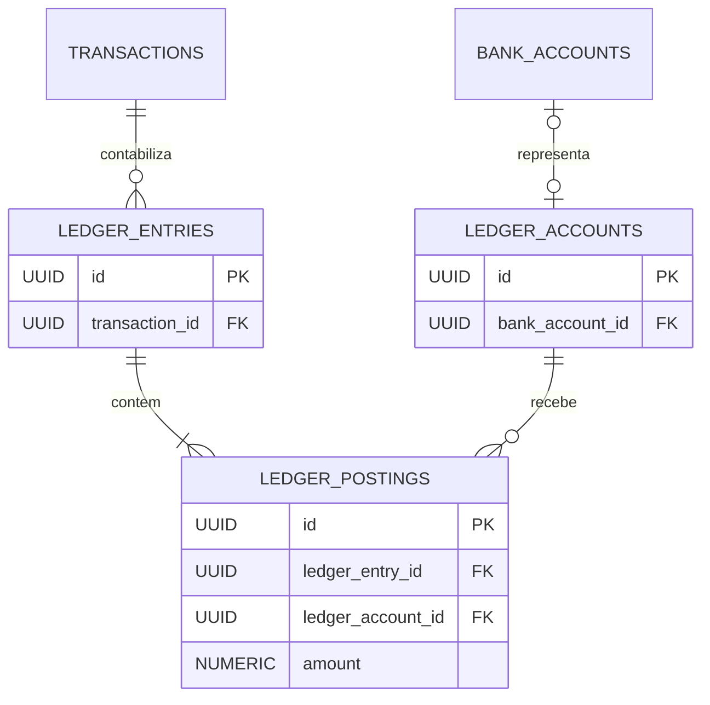

### 3.5. Payment

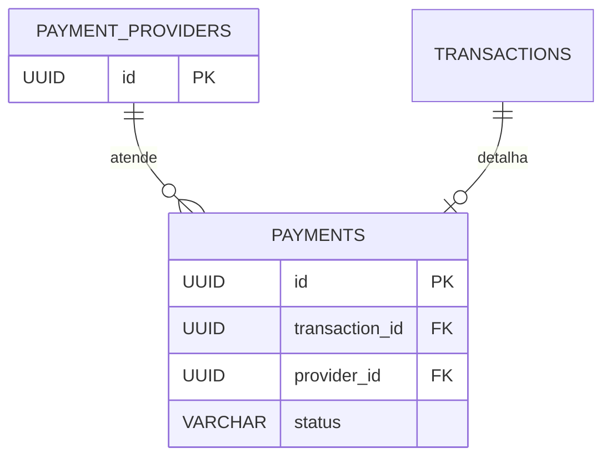

A conta de pagamento é alcançada por `PAYMENTS -> TRANSACTIONS -> BANK_ACCOUNTS`; não há FK direta de pagamento para conta.

### 3.6. Loan

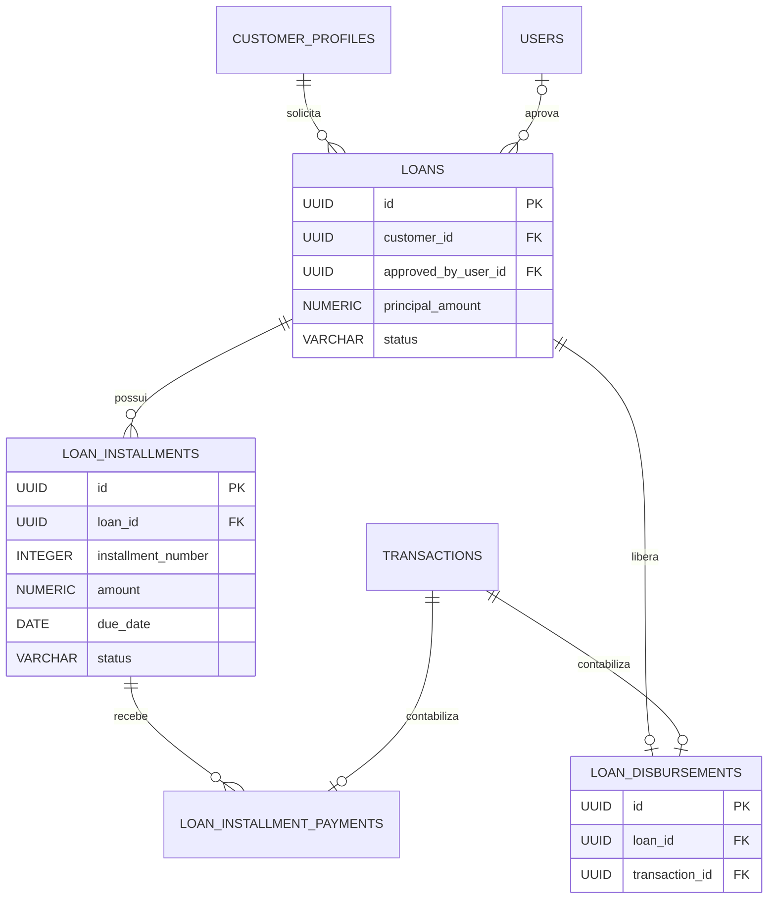

`LOAN_INSTALLMENT_PAYMENTS` é associação lógica aprovada. Os nomes de referência exibidos no bloco são rótulos lógicos, não colunas físicas aprovadas; o empréstimo é alcançado pela parcela.

### 3.7. Card

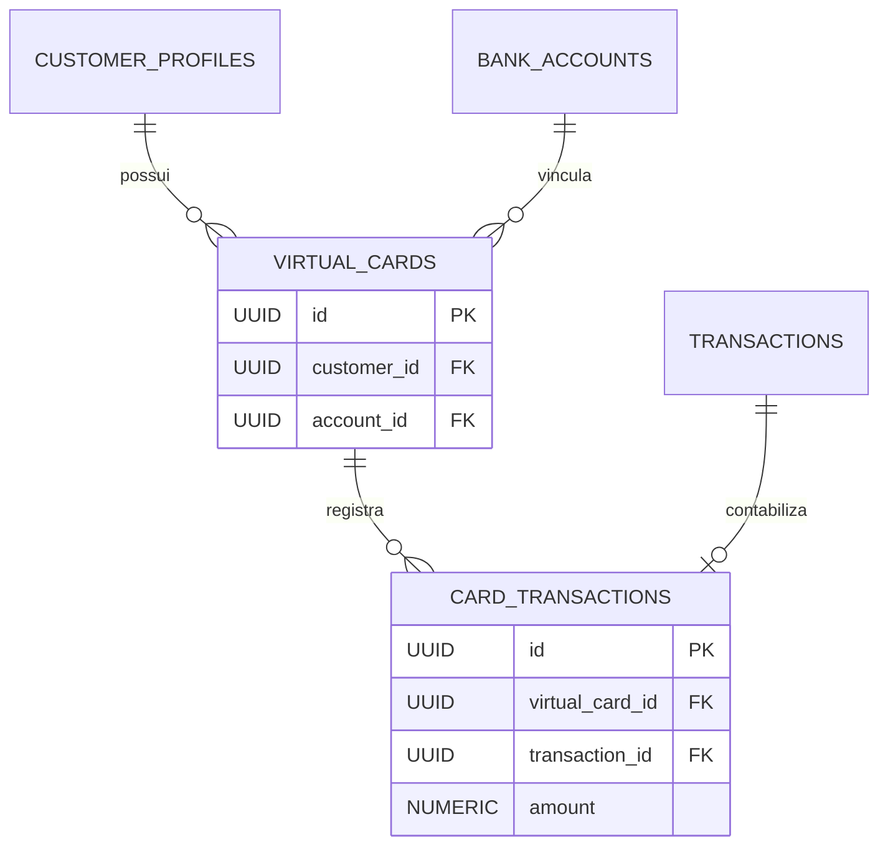

### 3.8. Notification

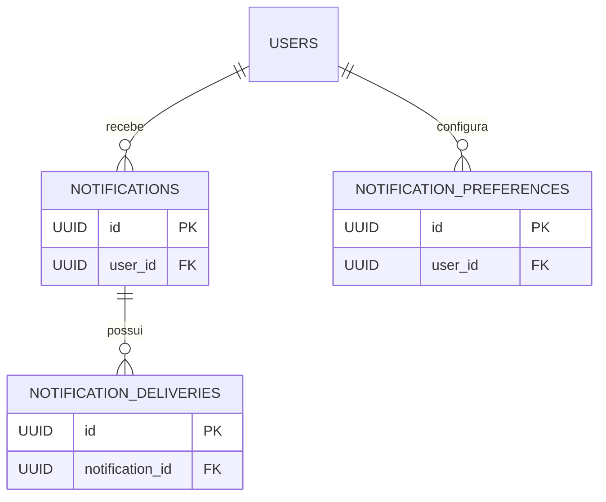

### 3.9. Admin e Audit

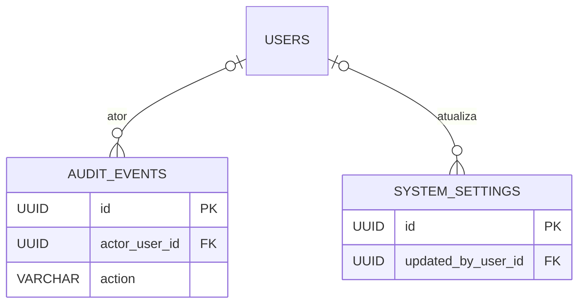

### 3.10. Infrastructure — Outbox

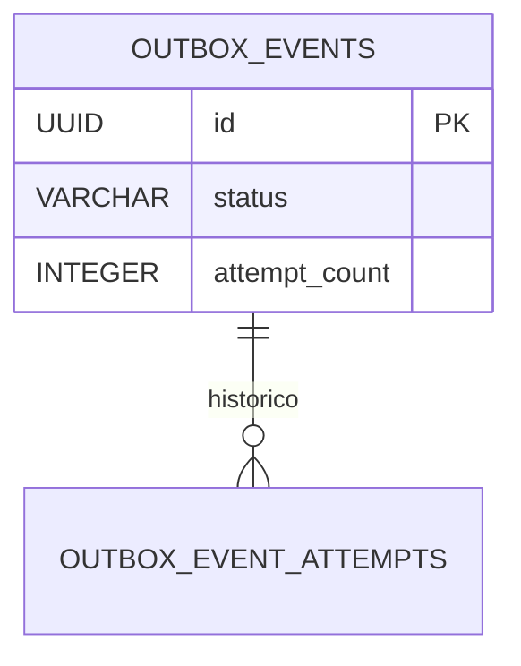

`OUTBOX_EVENT_ATTEMPTS` é entidade lógica. Seus atributos físicos continuam pendentes e não são listados.

### 3.11. Privacy

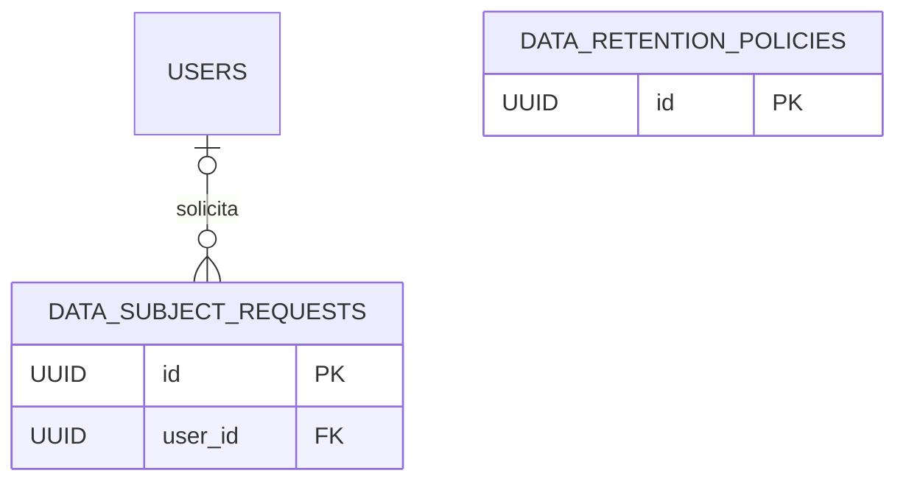

# 4. Dicionário de dados

A seguir estão as tabelas propostas, seus campos e suas responsabilidades.

Legenda:

- PK: chave primária.
- FK: chave estrangeira.
- UK: restrição de unicidade.
- NN: campo obrigatório (`NOT NULL`).
- NULL: campo opcional.

## 4.1. Módulo Identity — Identidade e autenticação

### 4.1.1. `users`

Armazena as credenciais e a identidade de acesso ao sistema.

| Campo | Tipo | Regras |
|---|---|---|
| `id` | UUID | PK, NN |
| `email` | VARCHAR(254) | NN, UK, normalizado |
| `password_hash` | VARCHAR(255) | NN |
| `role` | VARCHAR(20) | NN, `CUSTOMER` ou `ADMIN` |
| `status` | VARCHAR(20) | NN; valores definidos por `UserStatus` no OpenAPI: `PENDING`, `ACTIVE`, `BLOCKED`, `SUSPENDED`, `CLOSED` |
| `email_verified_at` | TIMESTAMPTZ | NULL |
| `last_login_at` | TIMESTAMPTZ | NULL |
| `created_at` | TIMESTAMPTZ | NN |
| `updated_at` | TIMESTAMPTZ | NN |

Regras:

- E-mail único, considerando normalização e comparação sem distinção entre maiúsculas e minúsculas.
- Senhas armazenadas como hash Argon2id, conforme ADR-009.
- Nunca armazenar senhas em texto puro.
- `ADMIN` e `CUSTOMER` são os únicos perfis.
- Não existe perfil `SUPPORT`.

### 4.1.2. `customer_profiles`

Armazena informações pessoais dos clientes.

| Campo | Tipo | Regras |
|---|---|---|
| `id` | UUID | PK, NN |
| `user_id` | UUID | FK → `users.id`, NN, UK |
| `full_name` | VARCHAR(150) | NN |
| CPF protegido | Representação física a definir | Campos, tipos e nomes físicos pendentes; ver § 4.12.5 |
| `phone_number` | VARCHAR(20) | NULL |
| `birth_date` | DATE | NULL |
| `declared_income` | NUMERIC(19,2) | NULL, maior ou igual a zero |
| `created_at` | TIMESTAMPTZ | NN |
| `updated_at` | TIMESTAMPTZ | NN |
| `status` | VARCHAR(20) | NN; valores definidos por `CustomerStatus` no OpenAPI: `PENDING`, `ACTIVE`, `BLOCKED`, `SUSPENDED`, `CLOSED` |

Regras:

- Um usuário CUSTOMER possui, no máximo, um perfil de cliente.
- O identificador é exclusivamente CPF na primeira versão; sua representação deve cumprir AES-256-GCM, HMAC-SHA-256 independente e versionamento para rotação. `document_number` em texto simples não é suficiente. Nomes e tipos físicos permanecem pendentes conforme § 4.12.5.
- A renda é declarada pelo cliente e utilizada nas regras simuladas de empréstimo.
- O perfil não substitui a entidade de autenticação.

### 4.1.3. `refresh_token_sessions`

Controla sessões e refresh tokens.

| Campo | Tipo | Regras |
|---|---|---|
| `id` | UUID | PK |
| `user_id` | UUID | FK → `users.id`, NN |
| `token_hash` | VARCHAR(255) | NN, UK |
| `family_id` | UUID | NN |
| `created_at` | TIMESTAMPTZ | NN |
| `expires_at` | TIMESTAMPTZ | NN |
| `revoked_at` | TIMESTAMPTZ | NULL |
| `replaced_by_session_id` | UUID | FK → `refresh_token_sessions.id`, NULL |
| `ip_address` | VARCHAR(45) | NULL |
| `user_agent` | TEXT | NULL |

Regras:

- Armazenar hash, nunca o refresh token original.
- Rotação de tokens controlada transacionalmente.
- Reutilização de token revogado deve ser detectada.
- Logout revoga a sessão correspondente.
- Permitir encerramento de sessões por usuário e por administração autorizada.

### 4.1.4. `totp_credentials`

Armazena a configuração de autenticação TOTP.

| Campo | Tipo | Regras |
|---|---|---|
| `id` | UUID | PK |
| `user_id` | UUID | FK → `users.id`, NN, UK |
| `encrypted_secret` | TEXT | NN |
| `enabled` | BOOLEAN | NN |
| `confirmed_at` | TIMESTAMPTZ | NULL |
| `last_used_at` | TIMESTAMPTZ | NULL |
| `created_at` | TIMESTAMPTZ | NN |
| `updated_at` | TIMESTAMPTZ | NN |

Regras:

- O segredo TOTP deve ser criptografado.
- ADMIN deve possuir TOTP ativo para acessar o painel.
- CUSTOMER pode habilitar ou desabilitar 2FA conforme as regras de segurança.
- Desativação exige reautenticação.
- Não permitir desativação de 2FA para ADMIN.

### 4.1.5. `recovery_codes`

Armazena códigos de recuperação de uso único.

| Campo | Tipo | Regras |
|---|---|---|
| `id` | UUID | PK |
| `user_id` | UUID | FK → `users.id`, NN |
| `code_hash` | VARCHAR(255) | NN |
| `used_at` | TIMESTAMPTZ | NULL |
| `created_at` | TIMESTAMPTZ | NN |

Regras:

- Armazenar somente hashes.
- Cada código poderá ser utilizado uma única vez.
- Códigos utilizados não poderão ser reutilizados.

### 4.1.6. `login_history`

Histórico de tentativas e acessos.

| Campo | Tipo | Regras |
|---|---|---|
| `id` | UUID | PK |
| `user_id` | UUID | FK → `users.id`, NULL |
| `email_attempted` | VARCHAR(254) | NULL |
| `ip_address` | VARCHAR(45) | NULL |
| `user_agent` | TEXT | NULL |
| `success` | BOOLEAN | NN |
| `failure_reason` | VARCHAR(50) | NULL |
| `occurred_at` | TIMESTAMPTZ | NN |

Regras:

- Registrar tentativas bem-sucedidas e malsucedidas.
- Evitar armazenar dados sensíveis desnecessários.
- Utilizar os registros para investigação e alertas de segurança.

### 4.1.7. `authentication_challenges`

Controla desafios de autenticação adicional, inclusive a simulação de 2FA no ambiente de desenvolvimento.

| Campo | Tipo | Regras |
|---|---|---|
| `id` | UUID | PK |
| `user_id` | UUID | FK → `users.id`, NN |
| `challenge_type` | VARCHAR(30) | NN |
| `code_hash` | VARCHAR(255) | NULL |
| `status` | VARCHAR(20) | NN |
| `attempt_count` | INTEGER | NN, padrão 0 |
| `max_attempts` | INTEGER | NN |
| `expires_at` | TIMESTAMPTZ | NN |
| `consumed_at` | TIMESTAMPTZ | NULL |
| `created_at` | TIMESTAMPTZ | NN |

Regras:

- O prazo de dois minutos refere-se exclusivamente ao código demonstrativo de seis dígitos, isolado para desenvolvimento, conforme a especificação funcional.
- O desafio de login com 2FA tem validade de cinco minutos, conforme os contratos REST v1.1. Esse desafio não se confunde com o código demonstrativo; os prazos não são intercambiáveis.
- Novo código invalida o anterior para o mesmo desafio.
- Tentativas limitadas.
- Código demonstrativo acessível exclusivamente pelo mecanismo de desenvolvimento.
- Não expor o código em respostas ou logs de produção.

### 4.1.8. `password_reset_tokens`

Controla solicitações de redefinição de senha.

| Campo | Tipo | Regras |
|---|---|---|
| `id` | UUID | PK |
| `user_id` | UUID | FK → `users.id`, NN |
| `token_hash` | VARCHAR(255) | NN, UK |
| `expires_at` | TIMESTAMPTZ | NN |
| `used_at` | TIMESTAMPTZ | NULL |
| `created_at` | TIMESTAMPTZ | NN |

### 4.1.9. `email_verification_tokens`

Controla a verificação de e-mail.

| Campo | Tipo | Regras |
|---|---|---|
| `id` | UUID | PK |
| `user_id` | UUID | FK → `users.id`, NN |
| `token_hash` | VARCHAR(255) | NN, UK |
| `expires_at` | TIMESTAMPTZ | NN |
| `used_at` | TIMESTAMPTZ | NULL |
| `created_at` | TIMESTAMPTZ | NN |

### 4.1.10. `admin_invitations`

Controla convites para criação de novos administradores.

| Campo | Tipo | Regras |
|---|---|---|
| `id` | UUID | PK |
| `email` | VARCHAR(254) | NN |
| `token_hash` | VARCHAR(255) | NN, UK |
| `invited_by_user_id` | UUID | FK → `users.id`, NN |
| `status` | VARCHAR(20) | NN |
| `expires_at` | TIMESTAMPTZ | NN |
| `accepted_at` | TIMESTAMPTZ | NULL |
| `created_at` | TIMESTAMPTZ | NN |

Regras:

- O convite possui validade limitada e uso único.
- O destinatário define sua própria senha.
- Todos os administradores possuem o mesmo nível de acesso.
- O primeiro administrador é provisionado durante o bootstrap.
- Não permitir desativação do último administrador ativo.

---

## 4.2. Módulo Account — Contas e titulares

### 4.2.1. `bank_accounts`

Representa contas bancárias individuais ou conjuntas.

| Campo | Tipo | Regras |
|---|---|---|
| `id` | UUID | PK |
| `account_number` | VARCHAR(9) | NN, UK |
| `account_type` | VARCHAR(20) | NN, `INDIVIDUAL` ou `JOINT` |
| `status` | VARCHAR(20) | NN |
| `balance_projection` | NUMERIC(19,2) | NN, padrão 0 |
| `opened_at` | TIMESTAMPTZ | NN |
| `closed_at` | TIMESTAMPTZ | NULL |
| `created_at` | TIMESTAMPTZ | NN |
| `updated_at` | TIMESTAMPTZ | NN |

Regras:

- Número de conta composto por nove dígitos, com oito dígitos identificadores e um dígito verificador.
- Gerado automaticamente pelo backend.
- Unicidade garantida pelo banco.
- UUID é o identificador interno.
- `balance_projection` é uma projeção para consulta, nunca a fonte contábil oficial.
- O saldo oficial é obtido a partir do Ledger.
- Conta encerrada não poderá ser reativada diretamente.

Valores aceitos pelo contrato OpenAPI (`AccountStatus`): `PENDING`, `ACTIVE`, `BLOCKED`, `SUSPENDED`, `CLOSED`. A matriz de transições específica de cliente e conta não é definida aqui, pois não há matriz aprovada completa.

### 4.2.2. `account_holders`

Relaciona clientes às contas, mantendo o histórico de titularidade.

| Campo | Tipo | Regras |
|---|---|---|
| `id` | UUID | PK |
| `account_id` | UUID | FK → `bank_accounts.id`, NN |
| `customer_id` | UUID | FK → `customer_profiles.id`, NN |
| `ownership_percentage` | NUMERIC(5,2) | NULL |
| `status` | VARCHAR(20) | NN |
| `joined_at` | TIMESTAMPTZ | NN |
| `left_at` | TIMESTAMPTZ | NULL |
| `created_at` | TIMESTAMPTZ | NN |

Regras:

- Cliente participa de apenas uma conta ativa.
- Conta individual possui exatamente um titular ativo.
- Conta conjunta possui dois ou mais titulares ativos.
- Todos os titulares ativos possuem os mesmos direitos operacionais.
- Percentuais podem ser definidos ou permanecer indefinidos.
- Se definidos, todos os titulares ativos devem possuir percentual e a soma deve ser 100%.
- A saída de titular deve preservar o histórico.
- Não permitir remoção unilateral de titular.
- O histórico de titularidade não deve ser apagado.

A regra de uma conta ativa por cliente deverá ser garantida por índice único parcial ou mecanismo equivalente no PostgreSQL.

### 4.2.3. `account_invitations`

Controla convites para ingresso em contas conjuntas.

| Campo | Tipo | Regras |
|---|---|---|
| `id` | UUID | PK |
| `account_id` | UUID | FK → `bank_accounts.id`, NN |
| `invited_user_id` | UUID | FK → `users.id`, NN |
| `invited_by_customer_id` | UUID | FK → `customer_profiles.id`, NN |
| `status` | VARCHAR(20) | NN |
| `expires_at` | TIMESTAMPTZ | NN |
| `accepted_at` | TIMESTAMPTZ | NULL |
| `cancelled_at` | TIMESTAMPTZ | NULL |
| `created_at` | TIMESTAMPTZ | NN |

Regras:

- Apenas usuário já cadastrado pode ser convidado.
- Convite somente pode ser aceito pelo destinatário autenticado.
- Backend verifica se o destinatário já participa de outra conta.
- Convite possui validade limitada.
- Convites podem ser cancelados pelo criador ou ADMIN.
- Estados: `PENDING`, `ACCEPTED`, `EXPIRED`, `CANCELLED`.

---

## 4.3. Módulo Transaction — Operações financeiras

### 4.3.1. `transactions`

Entidade central de operações financeiras.

| Campo | Tipo | Regras |
|---|---|---|
| `id` | UUID | PK |
| `account_id` | UUID | FK → `bank_accounts.id`, NULL quando aplicável |
| `initiated_by_customer_id` | UUID | FK → `customer_profiles.id`, NULL para operações sistêmicas |
| `transaction_type` | VARCHAR(30) | NN |
| `status` | VARCHAR(20) | NN |
| `amount` | NUMERIC(19,2) | NN, maior que zero |
| `description` | VARCHAR(255) | NULL |
| `reference_code` | VARCHAR(100) | NULL, UK quando informado |
| `created_at` | TIMESTAMPTZ | NN |
| `updated_at` | TIMESTAMPTZ | NN |
| `completed_at` | TIMESTAMPTZ | NULL |

Tipos sugeridos:

`TRANSFER`, `DEPOSIT`, `WITHDRAWAL`, `PAYMENT`, `LOAN_DISBURSEMENT`, `CARD_PURCHASE`, `CARD_REFUND`, `REVERSAL`.

Estados:

`PENDING`, `PROCESSING`, `COMPLETED`, `REJECTED`, `FAILED`, `CANCELLED`.

Regras:

- A transação representa a operação de negócio.
- Os detalhes específicos ficam nas tabelas especializadas.
- Toda operação contabilizada deve possuir lançamentos correspondentes no Ledger.
- Operações financeiras devem ser idempotentes.
- Operações contabilizadas não podem ser apagadas ou editadas diretamente.

### 4.3.2. `transfers`

Detalha transferências entre contas MyBank.

| Campo | Tipo | Regras |
|---|---|---|
| `id` | UUID | PK |
| `transaction_id` | UUID | FK → `transactions.id`, NN, UK |
| `source_account_id` | UUID | FK → `bank_accounts.id`, NN |
| `destination_account_id` | UUID | FK → `bank_accounts.id`, NN |
| `recipient_description` | VARCHAR(150) | NULL |

Regras:

- Origem e destino devem ser diferentes.
- Ambas as contas devem estar aptas a operar.
- A conta de origem precisa ter saldo suficiente no processamento.
- A titularidade e as permissões devem ser validadas no backend.
- Transferências são exclusivamente internas ao MyBank.

### 4.3.3. `deposits`

Detalha depósitos simulados.

| Campo | Tipo | Regras |
|---|---|---|
| `id` | UUID | PK |
| `transaction_id` | UUID | FK → `transactions.id`, NN, UK |
| `simulated_origin` | VARCHAR(100) | NN |
| `origin_reference` | VARCHAR(100) | NULL |

Regras:

- Depósito utiliza uma conta contábil de compensação.
- A entrada no saldo do cliente possui contrapartida contábil.
- Não existe integração bancária externa.

### 4.3.4. `withdrawals`

Detalha saques simulados.

| Campo | Tipo | Regras |
|---|---|---|
| `id` | UUID | PK |
| `transaction_id` | UUID | FK → `transactions.id`, NN, UK |
| `simulated_destination` | VARCHAR(100) | NN |
| `destination_reference` | VARCHAR(100) | NULL |

Regras:

- Saque utiliza uma conta contábil de compensação.
- O débito na conta do cliente deve possuir contrapartida contábil.
- Saldo deve ser validado durante o processamento.

### 4.3.5. `transaction_status_history`

Registra as mudanças de estado das operações.

| Campo | Tipo | Regras |
|---|---|---|
| `id` | UUID | PK |
| `transaction_id` | UUID | FK → `transactions.id`, NN |
| `previous_status` | VARCHAR(20) | NULL |
| `new_status` | VARCHAR(20) | NN |
| `changed_by_user_id` | UUID | FK → `users.id`, NULL |
| `reason` | TEXT | NULL |
| `created_at` | TIMESTAMPTZ | NN |

Regras:

- Registrar cada transição.
- Estados finais não devem ser reabertos.
- Alterações devem respeitar a máquina de estados.

### 4.3.6. `transaction_reversals`

Registra estornos e operações compensatórias.

| Campo | Tipo | Regras |
|---|---|---|
| `id` | UUID | PK |
| `original_transaction_id` | UUID | FK → `transactions.id`, NN, UK |
| `reversal_transaction_id` | UUID | FK → `transactions.id`, NN, UK |
| `requested_by_user_id` | UUID | FK → `users.id`, NN |
| `reason` | TEXT | NN |
| `created_at` | TIMESTAMPTZ | NN |

Regras:

- Não modificar lançamentos contabilizados.
- Estorno deve gerar nova operação e novos lançamentos.
- Registrar motivo e responsável.
- Permitir no máximo uma reversão integral por transação original.
- Impedir estorno de transação compensatória.
- Manter a transação original e seus lançamentos imutáveis.

### 4.3.7. `idempotency_records`

Controla duplicidade de requisições financeiras.

| Campo | Tipo | Regras |
|---|---|---|
| `id` | UUID | PK |
| `idempotency_key` | VARCHAR(150) | NN |
| `user_id` | UUID | FK → `users.id`, NN |
| `operation_type` | VARCHAR(50) | NN |
| `request_hash` | VARCHAR(255) | NN |
| `transaction_id` | UUID | FK → `transactions.id`, NULL |
| `response_snapshot` | JSONB | NULL |
| `created_at` | TIMESTAMPTZ | NN |
| `expires_at` | TIMESTAMPTZ | NN |

Regras:

- Unicidade da chave por usuário e operação.
- Requisições repetidas com a mesma chave não podem executar novamente a operação.
- A mesma chave com conteúdo diferente deve ser rejeitada.
- A política de retenção deve impedir que uma chave ainda necessária seja removida prematuramente.

---

## 4.4. Módulo Ledger — Contabilidade

### 4.4.1. `ledger_accounts`

Representa contas contábeis internas.

| Campo | Tipo | Regras |
|---|---|---|
| `id` | UUID | PK |
| `bank_account_id` | UUID | FK → `bank_accounts.id`, NULL, UK quando informado |
| `account_code` | VARCHAR(50) | NN, UK |
| `account_name` | VARCHAR(120) | NN |
| `account_category` | VARCHAR(30) | NN |
| `normal_balance` | VARCHAR(10) | NN |
| `status` | VARCHAR(20) | NN |
| `created_at` | TIMESTAMPTZ | NN |

Categorias contábeis sugeridas:

`ASSET`, `LIABILITY`, `EQUITY`, `REVENUE`, `EXPENSE`.

Regras:

- Contas de clientes devem estar vinculadas à respectiva conta bancária.
- Contas de compensação representam origens e destinos simulados.
- Contas contábeis não devem ser removidas quando possuírem lançamentos históricos.

### 4.4.2. `ledger_entries`

Representa um conjunto de lançamentos contábeis de uma operação.

| Campo | Tipo | Regras |
|---|---|---|
| `id` | UUID | PK |
| `transaction_id` | UUID | FK → `transactions.id`, NN |
| `entry_type` | VARCHAR(30) | NN |
| `description` | VARCHAR(255) | NULL |
| `posted_at` | TIMESTAMPTZ | NN |
| `created_at` | TIMESTAMPTZ | NN |

Regras:

- Um lançamento contabilizado é imutável.
- Cada conjunto contábil deve possuir débitos e créditos equilibrados.
- Uma transação pode gerar mais de um conjunto de lançamentos, por exemplo, quando houver estorno ou ajuste.

### 4.4.3. `ledger_postings`

Armazena os débitos e créditos individuais.

| Campo | Tipo | Regras |
|---|---|---|
| `id` | UUID | PK |
| `ledger_entry_id` | UUID | FK → `ledger_entries.id`, NN |
| `ledger_account_id` | UUID | FK → `ledger_accounts.id`, NN |
| `direction` | VARCHAR(10) | NN, `DEBIT` ou `CREDIT` |
| `amount` | NUMERIC(19,2) | NN, maior que zero |
| `created_at` | TIMESTAMPTZ | NN |

Regras:

- Soma dos débitos deve ser igual à soma dos créditos em cada conjunto contábil.
- Não permitir alteração ou exclusão de lançamentos contabilizados.
- Correções devem utilizar novas operações compensatórias.
- O equilíbrio contábil deve ser validado na mesma transação que grava os lançamentos.

### 4.4.4. Projeção de saldo

A coluna `bank_accounts.balance_projection` é uma projeção de leitura do saldo contábil.

Regras:

- Atualizada na mesma transação que registra os lançamentos.
- Se qualquer parte da operação falhar, toda a transação deve ser revertida.
- Deve existir rotina de reconciliação entre a projeção e o Ledger.
- O Ledger permanece como fonte oficial do saldo.
- Operações pendentes não reservam valores nem reduzem o saldo disponível.

---

## 4.5. Módulo Payment — Pagamentos simulados

### 4.5.1. `payment_providers`

Representa empresas fictícias que recebem pagamentos.

| Campo | Tipo | Regras |
|---|---|---|
| `id` | UUID | PK |
| `name` | VARCHAR(120) | NN |
| `category` | VARCHAR(30) | NN |
| `simulated_code_prefix` | VARCHAR(30) | NULL |
| `status` | VARCHAR(20) | NN |
| `created_at` | TIMESTAMPTZ | NN |

Categorias:

`WATER`, `ENERGY`, `INTERNET`, `TELEPHONY`, `GAS`, `OTHER`.

### 4.5.2. `payments`

Detalha os pagamentos de contas fictícias.

| Campo | Tipo | Regras |
|---|---|---|
| `id` | UUID | PK |
| `transaction_id` | UUID | FK → `transactions.id`, NN, UK |
| `provider_id` | UUID | FK → `payment_providers.id`, NN |
| `simulated_barcode` | VARCHAR(120) | NULL |
| `description` | VARCHAR(255) | NULL |
| `due_date` | DATE | NULL |
| `scheduled_at` | TIMESTAMPTZ | NULL |
| `paid_at` | TIMESTAMPTZ | NULL |
| `status` | VARCHAR(20) | NN |
| `created_at` | TIMESTAMPTZ | NN |

Estados:

`PENDING`, `SCHEDULED`, `PROCESSING`, `COMPLETED`, `REJECTED`, `FAILED`, `CANCELLED`.

Regras:

- Pagamentos são exclusivamente simulados.
- Não existe integração com concessionárias ou instituições externas.
- Não são transferências entre usuários.
- Pagamentos agendados não reservam saldo antecipadamente.
- No processamento, o saldo deve ser validado novamente.

---

## 4.6. Módulo Loan — Empréstimos

### 4.6.1. `loans`

Armazena solicitações e contratos de empréstimo.

| Campo | Tipo | Regras |
|---|---|---|
| `id` | UUID | PK |
| `customer_id` | UUID | FK → `customer_profiles.id`, NN |
| `principal_amount` | NUMERIC(19,2) | NN |
| `monthly_interest_rate` | NUMERIC(9,6) | NN |
| `installment_count` | INTEGER | NN |
| `installment_amount` | NUMERIC(19,2) | NULL |
| `total_amount` | NUMERIC(19,2) | NULL |
| `amortization_method` | VARCHAR(20) | NN, `PRICE` |
| `declared_income_snapshot` | NUMERIC(19,2) | NN |
| `committed_income_percentage` | NUMERIC(5,2) | NN |
| `approved_by_user_id` | UUID | FK → `users.id`, NULL |
| `approval_reason` | TEXT | NULL |
| `requested_at` | TIMESTAMPTZ | NN |
| `approved_at` | TIMESTAMPTZ | NULL |
| `contracted_at` | TIMESTAMPTZ | NULL |
| `expires_at` | TIMESTAMPTZ | NULL |
| `status` | VARCHAR(20) | NN |
| `created_at` | TIMESTAMPTZ | NN |
| `updated_at` | TIMESTAMPTZ | NN |

Estados:

`REQUESTED`, `UNDER_REVIEW`, `APPROVED`, `REJECTED`, `CONTRACTED`, `ACTIVE`, `PAID_OFF`, `CANCELLED`.

Regras:

- Sistema de amortização Price.
- Taxa de juros mensal.
- Condições aprovadas devem ser armazenadas como snapshot.
- Alterações futuras nas configurações não modificam contratos existentes.
- O comprometimento máximo permitido é de 30% da renda declarada. Esse teto é uma decisão aprovada; eventual configuração administrativa não pode ultrapassá-lo.
- A análise considera renda declarada e seu snapshot, empréstimos ativos, parcelas existentes, valor solicitado, prazo, juros e capacidade de pagamento.
- Aprovação manual exige justificativa e auditoria.
- Oferta aprovada deve possuir validade definida.
- Empréstimos simultâneos respeitam limites e concorrência.
- A liberação do valor gera operação financeira e lançamentos no Ledger.

### 4.6.2. `loan_installments`

Armazena parcelas dos empréstimos.

| Campo | Tipo | Regras |
|---|---|---|
| `id` | UUID | PK |
| `loan_id` | UUID | FK → `loans.id`, NN |
| `installment_number` | INTEGER | NN |
| `principal_component` | NUMERIC(19,2) | NN |
| `interest_component` | NUMERIC(19,2) | NN |
| `amount` | NUMERIC(19,2) | NN |
| `due_date` | DATE | NN |
| `paid_at` | TIMESTAMPTZ | NULL |
| `status` | VARCHAR(20) | NN |
| `created_at` | TIMESTAMPTZ | NN |

Estados:

`PENDING`, `PAID`, `OVERDUE`, `CANCELLED`.

Regras:

- Número da parcela único por empréstimo.
- A parcela vencida poderá ser paga.
- O pagamento deve atualizar a obrigação e gerar a operação contábil correspondente.
- Empréstimo somente poderá ser considerado quitado quando todas as obrigações estiverem liquidadas.

### 4.6.3. `loan_disbursements`

Registra a liberação do valor do empréstimo.

| Campo | Tipo | Regras |
|---|---|---|
| `id` | UUID | PK |
| `loan_id` | UUID | FK → `loans.id`, NN, UK |
| `transaction_id` | UUID | FK → `transactions.id`, NN, UK |
| `disbursed_at` | TIMESTAMPTZ | NN |

Regras:

- A liberação é simulada.
- A operação deve ser contabilizada no Ledger.
- A mudança para empréstimo ativo deve ser coerente com a conclusão da liberação.
- Não liberar valores sem contrapartida contábil.

---

## 4.7. Módulo Card — Cartões virtuais

### 4.7.1. `virtual_cards`

Armazena cartões virtuais demonstrativos.

| Campo | Tipo | Regras |
|---|---|---|
| `id` | UUID | PK |
| `customer_id` | UUID | FK → `customer_profiles.id`, NN |
| `account_id` | UUID | FK → `bank_accounts.id`, NN |
| `display_number` | VARCHAR(19) | NN |
| `cardholder_name` | VARCHAR(150) | NN |
| `expiration_month` | INTEGER | NN |
| `expiration_year` | INTEGER | NN |
| `spending_limit` | NUMERIC(19,2) | NN |
| `spent_amount` | NUMERIC(19,2) | NN, padrão 0 |
| `status` | VARCHAR(20) | NN |
| `created_at` | TIMESTAMPTZ | NN |
| `updated_at` | TIMESTAMPTZ | NN |
| `cancelled_at` | TIMESTAMPTZ | NULL |

Estados:

`ACTIVE`, `BLOCKED`, `CANCELLED`.

Regras:

- Cartões são virtuais e fictícios.
- Não possuem bandeira nem integração com compras reais.
- Limite é de gasto, não linha de crédito.
- Compras simuladas debitam diretamente a conta bancária.
- Cartão bloqueado não pode realizar novas compras.
- Cartão cancelado não pode ser reativado.
- Compras precisam respeitar saldo disponível e limite restante.
- Titular deve continuar ativo na conta vinculada.
- Dados de segurança de cartão não devem ser armazenados desnecessariamente.

### 4.7.2. `card_transactions`

Registra compras e estornos realizados com cartões.

| Campo | Tipo | Regras |
|---|---|---|
| `id` | UUID | PK |
| `virtual_card_id` | UUID | FK → `virtual_cards.id`, NN |
| `transaction_id` | UUID | FK → `transactions.id`, NN, UK |
| `merchant_name` | VARCHAR(120) | NN |
| `operation_type` | VARCHAR(20) | NN |
| `amount` | NUMERIC(19,2) | NN |
| `status` | VARCHAR(20) | NN |
| `created_at` | TIMESTAMPTZ | NN |

Regras:

- Compras e estornos são simulados.
- A movimentação financeira correspondente deve estar registrada no Ledger.
- Estornos recompõem saldo e limite de gasto, conforme a operação original.
- A atualização de saldo e limite deve ser atômica.

---

## 4.8. Módulo Notification — Notificações

### 4.8.1. `notifications`

Armazena notificações destinadas aos usuários.

| Campo | Tipo | Regras |
|---|---|---|
| `id` | UUID | PK |
| `user_id` | UUID | FK → `users.id`, NN |
| `event_type` | VARCHAR(50) | NN |
| `title` | VARCHAR(150) | NN |
| `message` | TEXT | NN |
| `status` | VARCHAR(20) | NN |
| `read_at` | TIMESTAMPTZ | NULL |
| `created_at` | TIMESTAMPTZ | NN |

### 4.8.2. `notification_preferences`

Armazena preferências de recebimento.

| Campo | Tipo | Regras |
|---|---|---|
| `id` | UUID | PK |
| `user_id` | UUID | FK → `users.id`, NN |
| `event_type` | VARCHAR(50) | NN |
| `channel` | VARCHAR(20) | NN |
| `enabled` | BOOLEAN | NN |
| `created_at` | TIMESTAMPTZ | NN |
| `updated_at` | TIMESTAMPTZ | NN |

Canais:

`IN_APP`, `EMAIL`, `PUSH`.

Regra de unicidade: usuário + evento + canal.

### 4.8.3. `notification_deliveries`

Controla tentativas de entrega.

| Campo | Tipo | Regras |
|---|---|---|
| `id` | UUID | PK |
| `notification_id` | UUID | FK → `notifications.id`, NN |
| `channel` | VARCHAR(20) | NN |
| `status` | VARCHAR(20) | NN |
| `attempt_count` | INTEGER | NN, padrão 0 |
| `last_attempt_at` | TIMESTAMPTZ | NULL |
| `delivered_at` | TIMESTAMPTZ | NULL |
| `failure_reason` | TEXT | NULL |
| `created_at` | TIMESTAMPTZ | NN |

Regras:

- E-mail será simulado no ambiente de desenvolvimento.
- Push utilizará a API de notificações do navegador, com autorização do usuário.
- Não incluir dados financeiros sensíveis desnecessários.
- Controlar tentativas e evitar notificações duplicadas.

---

## 4.9. Módulo Admin e Audit — Administração e auditoria

### 4.9.1. `audit_events`

Registra ações administrativas e eventos sensíveis de negócio.

| Campo | Tipo | Regras |
|---|---|---|
| `id` | UUID | PK |
| `actor_user_id` | UUID | FK → `users.id`, NULL para eventos sistêmicos |
| `action` | VARCHAR(100) | NN |
| `resource_type` | VARCHAR(80) | NN |
| `resource_id` | UUID | NULL |
| `reason` | TEXT | NULL |
| `before_data` | JSONB | NULL |
| `after_data` | JSONB | NULL |
| `ip_address` | VARCHAR(45) | NULL |
| `user_agent` | TEXT | NULL |
| `occurred_at` | TIMESTAMPTZ | NN |

Regras:

- Preservar ator, ação, recurso, momento e resultado; preservar correlação quando exigida/fornecida pelo contrato.
- Justificativa obrigatória nas ações administrativas sensíveis e críticas.
- Consultas sensíveis também devem ser auditadas.
- Auditoria não deve ser editável por operações administrativas comuns.
- Não armazenar senhas, tokens ou segredos.
- Alterações de dados pessoais devem evitar cópias desnecessárias de informações sensíveis em `before_data` e `after_data`.
- Não existe segunda aprovação administrativa.

### 4.9.2. `system_settings`

Armazena parâmetros de configuração do sistema.

| Campo | Tipo | Regras |
|---|---|---|
| `id` | UUID | PK |
| `setting_key` | VARCHAR(100) | NN, UK |
| `setting_value` | JSONB | NN |
| `description` | TEXT | NULL |
| `updated_by_user_id` | UUID | FK → `users.id`, NULL |
| `created_at` | TIMESTAMPTZ | NN |
| `updated_at` | TIMESTAMPTZ | NN |

Exemplos de parâmetros:

- Taxa de juros de empréstimos.
- Comprometimento máximo de renda.
- Valor mínimo e máximo de empréstimos.
- Prazo máximo de empréstimos.
- Validade de convites.
- Limites de tentativas de autenticação.
- Configurações de notificações.

Regras:

- Alterações críticas exigem justificativa e auditoria.
- Valores devem ser validados por tipo e faixa permitida.
- Segredos e credenciais não devem ser armazenados como configurações comuns.

---

## 4.10. Infraestrutura — Eventos assíncronos

### 4.10.1. `outbox_events`

Implementa o padrão Transactional Outbox.

| Campo | Tipo | Regras |
|---|---|---|
| `id` | UUID | PK |
| `aggregate_type` | VARCHAR(80) | NN |
| `aggregate_id` | UUID | NN |
| `event_type` | VARCHAR(100) | NN |
| `payload` | JSONB | NN |
| `status` | VARCHAR(20) | NN |
| `attempt_count` | INTEGER | NN, padrão 0; contador acumulado desnormalizado das tentativas registradas em `outbox_event_attempts` |
| `created_at` | TIMESTAMPTZ | NN |
| `processed_at` | TIMESTAMPTZ | NULL |
| `next_attempt_at` | TIMESTAMPTZ | NULL |
| `last_error` | TEXT | NULL |

Estados do domínio: `PENDING`, `PROCESSING`, `PROCESSED` e `FAILED`. `PROCESSED` indica sucesso; `FAILED` é o estado terminal elegível a reprocessamento, sujeito a validação e autorização. `DEAD_LETTER` é somente mecanismo operacional, não estado.

Regras:

- Evento deve ser gravado na mesma transação da operação de negócio correspondente.
- Processamento assíncrono não deve comprometer a consistência financeira.
- Consumidores devem ser idempotentes.
- Tentativas devem ser limitadas.
- O ciclo automático seleciona evento `PENDING` para processamento. Uma falha recuperável poderá retornar o evento a `PENDING` enquanto houver tentativas automáticas disponíveis, respeitando backoff progressivo. Esgotado o limite, o evento termina em `FAILED`.
- `FAILED` é elegível a reprocessamento manual somente após validação de elegibilidade e autorização. O reprocessamento autorizado inicia novo ciclo, preserva as tentativas anteriores e mantém o processamento idempotente.
- O registro individual da tentativa em `outbox_event_attempts` e a atualização de `attempt_count` devem ocorrer atomicamente na mesma transação.
- `attempt_count` serve a consultas rápidas e não substitui o histórico individual. Um mecanismo de reconciliação deve comparar o contador com os registros de tentativas; em caso de divergência, o histórico individual é a referência autoritativa.
- Falhas devem ser registradas.
- Não utilizar Kafka ou RabbitMQ inicialmente.

O mecanismo e a frequência operacional da reconciliação não foram definidos e permanecem para detalhamento técnico. Essa pendência não altera a autoridade do histórico individual.

---

## 4.11. Privacidade — LGPD e retenção

### 4.11.1. `data_subject_requests`

Registra solicitações dos titulares de dados pessoais.

| Campo | Tipo | Regras |
|---|---|---|
| `id` | UUID | PK |
| `user_id` | UUID | FK → `users.id`, NULL quando anonimizado |
| `request_type` | VARCHAR(40) | NN |
| `status` | VARCHAR(20) | NN |
| `description` | TEXT | NULL |
| `received_at` | TIMESTAMPTZ | NN |
| `completed_at` | TIMESTAMPTZ | NULL |
| `resolution_notes` | TEXT | NULL |

Tipos sugeridos:

`ACCESS`, `CORRECTION`, `ANONYMIZATION`, `DELETION`, `PORTABILITY`, `OTHER`.

Regras:

- Registrar e acompanhar solicitações.
- Não excluir registros financeiros cuja preservação seja necessária.
- Anonimizar ou eliminar dados pessoais quando aplicável.
- Avaliar cada solicitação conforme finalidade, base legal e obrigação de retenção.

### 4.11.2. `data_retention_policies`

Define políticas de retenção por categoria de informação.

| Campo | Tipo | Regras |
|---|---|---|
| `id` | UUID | PK |
| `data_category` | VARCHAR(80) | NN |
| `retention_period_days` | INTEGER | NULL |
| `legal_basis` | VARCHAR(150) | NULL |
| `description` | TEXT | NULL |
| `active` | BOOLEAN | NN |
| `created_at` | TIMESTAMPTZ | NN |
| `updated_at` | TIMESTAMPTZ | NN |

Regras:

- Não estabelecer prazos legais sem validação.
- Política deve ser documentada e revisável.
- Retenção de dados pessoais deve ser separada da preservação do histórico contábil.

## 4.12. Estruturas adicionais aprovadas

As estruturas desta seção são necessárias para cumprir decisões aprovadas posteriores à versão 1.0. Requisito lógico e definição física são distinguidos; esta documentação não cria SQL ou migrações.

### 4.12.1. `customer_status_history`

Registra cada transição de `customer_profiles.status`.

| Dado lógico | Representação documental |
|---|---|
| Identidade do registro | UUID conforme convenção do modelo |
| Cliente | Referência obrigatória a `customer_profiles` |
| Estado anterior | Preservado; sem valor anterior apenas na criação inicial |
| Novo estado | Preservado com os valores de `CustomerStatus` do OpenAPI |
| Momento da transição | Preservado como instante temporal |
| Autoria | Identificação do autor responsável pela transição; forma física da autoria sistêmica, se aplicável, deve manter rastreabilidade |

Toda transição deve ser registrada sem alterar o histórico. Nenhum estado ou transição adicional é introduzido.

### 4.12.2. `bank_account_status_history`

Registra cada transição de `bank_accounts.status`.

| Dado lógico | Representação documental |
|---|---|
| Identidade do registro | UUID conforme convenção do modelo |
| Conta | Referência obrigatória a `bank_accounts` |
| Estado anterior | Preservado; sem valor anterior apenas na criação inicial |
| Novo estado | Preservado com os valores de `AccountStatus` do OpenAPI |
| Momento da transição | Preservado como instante temporal |
| Autoria | Identificação do autor responsável pela transição; forma física da autoria sistêmica, se aplicável, deve manter rastreabilidade |

Toda transição deve ser registrada sem alterar o histórico. Nenhum estado ou transição adicional é introduzido.

### 4.12.3. `outbox_event_attempts` — entidade lógica

É a fonte autoritativa do histórico individual de tentativas associadas a um `outbox_event`: um evento tem zero ou mais registros de tentativa; cada tentativa pertence a um evento. Registra as execuções automáticas e os reprocessamentos manuais, preservando o histórico para auditoria e reconstrução da quantidade de tentativas.

O histórico é a referência para reconciliar `outbox_events.attempt_count`, contador acumulado desnormalizado e não autoritativo. O registro individual da tentativa e a atualização do contador devem ser atômicos. O requisito aprovado também abrange preservação das tentativas anteriores, limite de tentativas, backoff progressivo, falha terminal `FAILED`, idempotência dos consumidores e reprocessamento controlado. O sucesso é `PROCESSED`; `DEAD_LETTER` é mecanismo operacional.

**Definição física pendente:** atributos, tipos, nulabilidade, constraints e índices de cada tentativa não estão especificados em fonte aprovada. Este documento não os inventa.

### 4.12.4. `loan_installment_payments` — associação persistente

Representa o pagamento persistente de parcela aprovado. Associa a parcela de `loan_installments` à transação financeira correspondente em `transactions`; o empréstimo é identificável pela relação da parcela com `loans`. Não depende de uma conta bancária ativa.

A estrutura deve permitir identificar empréstimo, parcela, pagamento e transação. O contrato REST/OpenAPI expõe identificador do pagamento, empréstimo, parcela, valor, estado, método `SIMULATED_SETTLEMENT` e momento do pagamento. O mapeamento deve preservar pagamento integral, idempotência, liquidação simulada e contabilização por contas de compensação. A parcela só é considerada paga após liquidação bem-sucedida.

**Definição física pendente:** nomes/tipos das colunas e eventual redundância de referência não estão fixados. As relações lógicas aprovadas são obrigatórias; não se adicionam atributos físicos não aprovados. Este fluxo não se confunde com `payments` de serviços fictícios.

### 4.12.5. Representação protegida do CPF

A representação persistida deve contemplar, em termos lógicos, CPF cifrado com AES-256-GCM, nonce, tag de autenticação, versão/identificador da chave criptográfica, HMAC-SHA-256 independente para busca e unicidade e versão/identificador HMAC quando necessário para rotação. Chaves permanecem fora do banco e do código-fonte.

`document_number` em texto simples e com unicidade direta não é representação suficiente. A forma de armazenamento, nomes físicos e tipos das colunas permanecem pendentes de detalhamento no dicionário antes da implementação. A busca e unicidade precisam continuar possíveis durante a rotação.

### 4.12.6. Snapshot contratual de empréstimo

O snapshot lógico deve permitir reconstruir as condições aprovadas: principal, taxa mensal, sistema PRICE, quantidade e valores das parcelas, primeira data e vencimentos, total de juros, total contratado, condições aplicadas, momento da aprovação e contratação e versão das condições.

`loans` e `loan_installments` já representam parte desses dados. O total de juros não é declarado como persistido nem como derivado; essa escolha permanece pendente. O mecanismo físico de imutabilidade ainda não está definido. O snapshot permanece imutável retroativamente e disponível após a quitação; não se cria uma tabela snapshot adicional nesta etapa.

### 4.12.7. Auditoria e idempotência

`audit_events` deve preservar ator, ação, recurso, momento, resultado e correlação quando aplicável. A justificativa é obrigatória nas ações administrativas críticas. O contrato OpenAPI define resultado `SUCCESS`/`FAILURE` e identificador de correlação. O dicionário-base não define colunas físicas para resultado e correlação; a forma de persistir ou obter esses dados deve ser fechada sem presumir nomes ou tipos de colunas.

`idempotency_records` já contempla chave, usuário, tipo de operação, hash do pedido e resultado. O resultado idempotente deve identificar a operação aceita/criada, inclusive quando assíncrona. A forma de associação física entre registro idempotente e evento Outbox permanece pendente; não se cria FK sem definição aprovada.

# 5. Restrições e integridade

As categorias abaixo descrevem garantias lógicas, não SQL nem migrações.

| Regra | Classe | Definição documental |
|---|---|---|
| Identificadores | PRIMARY KEY | UUID para cada entidade |
| Referências | FOREIGN KEY | Correspondem às FKs do dicionário e relações do DER |
| E-mail | UNIQUE + normalização | Único após normalização |
| CPF | UNIQUE sobre representação de busca | Unicidade via HMAC-SHA-256, nunca sobre ciphertext |
| Número de conta | UNIQUE + CHECK | Nove dígitos, incluindo dígito verificador |
| Perfil por identidade | UNIQUE | No máximo um `customer_profiles` por usuário |
| Sessões e tokens | UNIQUE | Hashes dos tokens conforme convenções de segurança |
| Conta ativa por cliente | Índice único parcial | Um vínculo ativo em `account_holders` |
| Quantidade de titulares | Validação transacional/domínio | Individual com exatamente um titular; conjunta com pelo menos dois |
| Percentuais | CHECK + validação transacional | Entre 0–100; se definidos, completos e somam 100% |
| Transferência | CHECK/domínio | Conta de origem diferente do destino |
| Valores financeiros | CHECK | Valores positivos onde exigido; BRL em `NUMERIC(19,2)` |
| Parcela por empréstimo | UNIQUE | `installment_number` único por empréstimo |
| Pagamento de parcela | Idempotência + domínio | Integral, associado a transação e parcela, sem liquidação duplicada |
| Reversão | UNIQUE + domínio | Uma reversão por transação original; transação compensatória única |
| Reversão de reversão | Regra de domínio | Transação compensatória não pode ser origem de estorno genérico |
| Preferências | UNIQUE | Usuário, evento e canal |
| Idempotência | UNIQUE contextual | Chave única por usuário e operação |
| Ledger | Validação transacional | Débitos = créditos; partidas positivas e direção controlada |
| Projeção de saldo | Validação transacional | Atualizada atomicamente e reconciliável com Ledger |
| Configuração de estorno | Domínio + auditoria | Limites configuráveis obrigatórios; sem valores arbitrários |
| Histórico de status | Domínio + preservação | Cada transição de cliente/conta registrada sem apagar histórico |
| Outbox | Domínio + idempotência | Tentativas limitadas, histórico preservado e estado terminal definido |
| Registros financeiros | Regra de preservação | Ledger e transações não são apagados por operação administrativa comum |

Regras entre múltiplas linhas (contagem de titulares, percentuais totais, equilíbrio contábil, saldo e limites) dependem de transação e validação adequada; não são substituídas por `CHECK` simplificado.

## 5.1. Índices

Os índices originais permanecem candidatos a validar conforme os padrões de consulta. Índices únicos parciais necessários para regras de titularidade e unicidade de pagamento devem ser identificados na definição física. Índices de tentativas Outbox permanecem pendentes enquanto os atributos não forem definidos.

# 6. Estados

## 6.1. Status aprovados no contrato OpenAPI

| Contexto | Enumeração |
|---|---|
| `users.status` | `PENDING`, `ACTIVE`, `BLOCKED`, `SUSPENDED`, `CLOSED` |
| `customer_profiles.status` | `PENDING`, `ACTIVE`, `BLOCKED`, `SUSPENDED`, `CLOSED` |
| `bank_accounts.status` | `PENDING`, `ACTIVE`, `BLOCKED`, `SUSPENDED`, `CLOSED` |
| `outbox_events.status` | `PENDING`, `PROCESSING`, `PROCESSED`, `FAILED` |
| Pagamento de parcela (contrato) | `COMPLETED`, `FAILED`, `REJECTED` |

As situações de usuário, cliente e conta são controles separados, ainda que os enums tenham os mesmos valores no OpenAPI. `DISABLED` da versão 1.0 é removido. Não são acrescentados estados.

## 6.2. Outbox

`PROCESSED` significa sucesso. `FAILED` é falha terminal elegível a reprocessamento manual somente após as verificações de elegibilidade, autorização, idempotência e concorrência. `DEAD_LETTER` é encaminhamento ou armazenamento operacional, não estado de domínio.

## 6.3. Máquinas de estados documentadas

As transições da versão-base são preservadas para as entidades em que já estão descritas:

| Contexto | Transições documentadas |
|---|---|
| Transação | `PENDING` → `PROCESSING` ou `CANCELLED`; `PROCESSING` → `COMPLETED`, `FAILED` ou `REJECTED`; estados finais não podem ser reabertos |
| Pagamento de serviço | `PENDING` → `SCHEDULED`, `PROCESSING` ou `CANCELLED`; `SCHEDULED` → `PROCESSING` ou `CANCELLED`; `PROCESSING` → `COMPLETED`, `FAILED` ou `REJECTED` |
| Empréstimo | `REQUESTED` → `UNDER_REVIEW`, `REJECTED` ou `CANCELLED`; `UNDER_REVIEW` → `APPROVED` ou `REJECTED`; `APPROVED` → `CONTRACTED` ou `CANCELLED`; `CONTRACTED` → `ACTIVE`; `ACTIVE` → `PAID_OFF` |
| Parcela | `PENDING` → `PAID`, `OVERDUE` ou `CANCELLED`; `OVERDUE` → `PAID` |
| Convite | `PENDING` → `ACCEPTED`, `EXPIRED` ou `CANCELLED` |
| Cartão | `ACTIVE` → `BLOCKED` ou `CANCELLED`; `BLOCKED` → `ACTIVE` ou `CANCELLED`; `CANCELLED` é final |
| Outbox | `PENDING` → `PROCESSING`; processamento bem-sucedido termina em `PROCESSED`; falha terminal termina em `FAILED`; reprocessamento administrativo elegível inicia novo ciclo em `PENDING` |

Os históricos de transição de clientes e contas são entidades próprias. Seus valores de status estão definidos em § 6.1, mas não se publica matriz de transições porque as fontes aprovadas não fornecem uma matriz completa. A enumeração não autoriza inferir transições.

# 7. Consistência financeira

- Ledger é a fonte oficial do saldo e utiliza partidas dobradas.
- Cada conjunto contabilizado mantém débitos iguais a créditos na mesma transação.
- Lançamentos contabilizados são imutáveis; correções geram novas operações compensatórias.
- `balance_projection` é projeção de leitura, atualizada atomicamente e reconciliável.
- Operações pendentes não reservam saldo; condições são revalidadas no processamento.
- Pagamento de parcela usa liquidação simulada sem dependência de conta ativa, é integral, idempotente e contabilizado por contas de compensação. A parcela só passa a paga após liquidação bem-sucedida.
- Empréstimos e pagamentos de parcelas seguem fluxos específicos de correção; não usam o estorno genérico.
- Administradores não alteram saldo diretamente.

# 8. Segurança, privacidade e preservação

- CPF é o único documento da primeira versão e deve cumprir os requisitos criptográficos da § 4.12.5.
- Chaves criptográficas ficam fora do banco e do código-fonte. CPF, ciphertext e HMAC do CPF não devem aparecer em logs.
- Snapshot do empréstimo é imutável e preservado após quitação.
- Auditoria preserva ações administrativas e consultas sensíveis, ator, ação, recurso, momento, resultado e correlação quando aplicável. Justificativa é obrigatória nas operações críticas.
- `idempotency_records` preserva chave, usuário, operação, hash da requisição e resultado idempotente.
- Histórico financeiro, Ledger, auditoria, mudanças de status e tentativas Outbox não podem ser apagados por operações comuns.
- Solicitações de titulares e retenção devem respeitar finalidade, base legal e obrigações aplicáveis; nenhum prazo legal é inventado.

# 9. Organização por módulos

| Módulo | Entidades |
|---|---|
| Identity | `users`, `refresh_token_sessions`, `totp_credentials`, `recovery_codes`, `login_history`, `authentication_challenges`, `password_reset_tokens`, `email_verification_tokens`, `admin_invitations` |
| Customer | `customer_profiles`, `customer_status_history` |
| Account | `bank_accounts`, `account_holders`, `account_invitations`, `bank_account_status_history` |
| Transaction | `transactions`, `transfers`, `deposits`, `withdrawals`, `transaction_status_history`, `transaction_reversals`, `idempotency_records` |
| Ledger | `ledger_accounts`, `ledger_entries`, `ledger_postings` |
| Payment | `payment_providers`, `payments` (serviços fictícios) |
| Loan | `loans`, `loan_installments`, `loan_disbursements`, `loan_installment_payments` |
| Card | `virtual_cards`, `card_transactions` |
| Notification | `notifications`, `notification_preferences`, `notification_deliveries` |
| Admin / Audit | `audit_events`, `system_settings` |
| Infrastructure | `outbox_events`, `outbox_event_attempts` (entidade lógica; campos pendentes) |
| Privacy | `data_subject_requests`, `data_retention_policies` |

**Cobertura:** 38 entidades originais e quatro estruturas adicionais aprovadas: 42 entidades ou estruturas lógicas. `outbox_event_attempts` permanece sem atributos físicos definidos.

# 10. Pendências técnicas

As pendências abaixo tratam da representação técnica, não dos requisitos de negócio aprovados:

1. Nomes e tipos físicos da representação cifrada/HMAC do CPF e detalhes operacionais da rotação.
2. Atributos, tipos, nulabilidade, constraints e índices dos registros individuais de tentativa Outbox.
3. Intervalos exatos do backoff e demais parâmetros operacionais não aprovados.
4. Mapeamento físico da associação de pagamento de parcela além das relações lógicas e propriedades contratuais já aprovadas.
5. Mapeamento da versão das condições contratuais e decisão documentada sobre persistir ou derivar total de juros.
6. Fonte física de resultado/correlação da auditoria se a operação não os mantiver diretamente; associação física entre idempotência e evento Outbox.
7. Valores numéricos dos limites configuráveis de estorno.
8. Definição física de índices parciais e garantias transacionais, preservando as invariantes aprovadas.

Pagamento simulado após encerramento de conta, estrutura lógica de pagamento de parcela, separação/históricos de status, requisitos funcionais da Outbox e política de estorno não são pendências de decisão nesta consolidação.

# 11. Rastreabilidade e critérios de revisão

## 11.1. Fontes utilizadas

- [ADRs](../01-decisoes/adr.md): PostgreSQL/UUID, precisão monetária, Ledger, Outbox, segurança, contas conjuntas, empréstimos, auditoria e privacidade.
- [Decisões técnicas complementares v1.1](../01-decisoes/decisoes-tecnicas-complementares.md): CPF, criptografia, snapshot, estornos e reprocessamento Outbox.
- [Especificação funcional](../02-requisitos/especificacao-funcional.md): requisitos funcionais e estados; o documento base é proposta, usando-se como normativas as decisões confirmadas.
- [Arquitetura](../03-arquitetura/arquitetura-e-diagramas.md): módulos, Ledger, Outbox e segurança; anotações antigas de pendência são superadas por decisões posteriores aprovadas.
- [Contratos REST v1.1](../05-api/contratos-rest.md): contratos e fechamentos aprovados; o documento se identifica como proposta consolidada para revisão.
- [OpenAPI 3.1.1](../05-api/openapi.yaml): enums e propriedades contratuais aceitos na etapa OpenAPI; versão da API 1.1.0.
- [Fluxos de negócio](../06-fluxos/fluxos-de-negocio.md): fluxos-base são proposta; decisões complementares explicitamente aprovadas são incorporadas.
- [Documento original v1.0](../99-fontes-originais/MyBank%20—%20Documento%20de%20Modelagem%20do%20Banco%20de%20Dados.md): preservado; proposta usada como base dos 38 itens originais, não como decisão automática.

## 11.2. Critérios

- Todas as 38 entidades-base e quatro estruturas aprovadas constam do dicionário e do DER; a entidade lógica Outbox é mostrada sem campos ainda não definidos.
- Cada FK física tem relação correspondente; associações físicas pendentes estão rotuladas como lógicas.
- Cardinalidades refletem nulabilidade e unicidade documentadas e relações com papéis distintos são identificadas.
- Estados coincidem com definições aprovadas; nenhuma transição é inferida.
- Pagamentos de parcelas, Ledger, estornos, CPF, snapshot, auditoria e idempotência são alinhados às decisões aprovadas.
- Pendências técnicas permanecem explícitas, sem valores ou campos inventados.
- A versão 1.1 é submetida a revisão humana e não declara aprovação final da modelagem ou da Etapa 9.

**Estado:** consolidação documental v1.1 para revisão. A aprovação depende de revisão explícita do usuário e da resolução ou aceitação formal das pendências técnicas.
