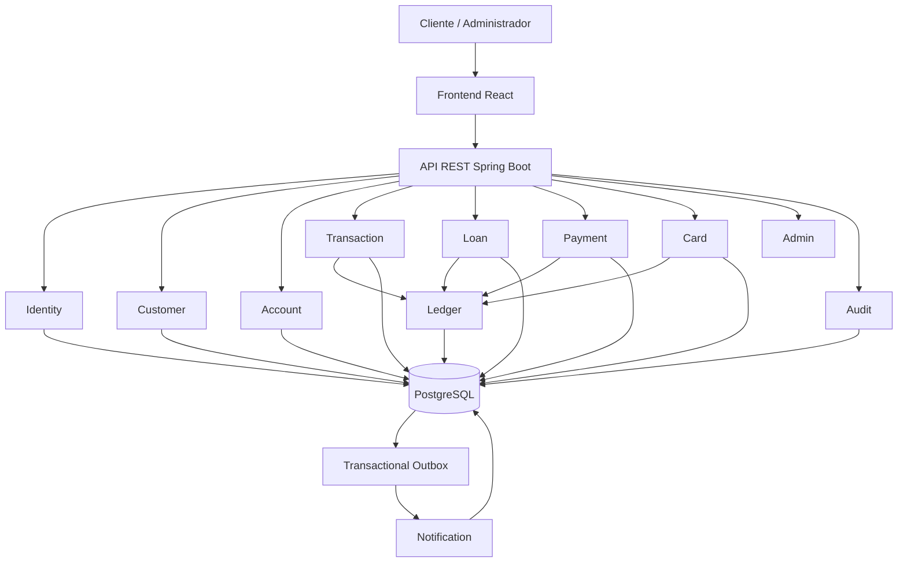

# MyBank — Consolidação da Documentação Técnica e Arquitetural

**Etapa:** Consolidação documental  
**Versão:** 1.0 — Proposta para revisão  
**Status:** Aguardando aprovação  
**Projeto:** MyBank — Banco digital fictício para portfólio

---

# 1. Objetivo

Consolidar os requisitos, decisões arquiteturais, regras de negócio, modelagem de dados, contratos de API e parâmetros operacionais do MyBank em uma documentação coerente.

A documentação será a principal referência para orientar o desenvolvimento com Codex.

Nenhuma decisão anteriormente aprovada deverá ser modificada silenciosamente.

# 2. Estrutura documental proposta

A documentação será organizada dentro de uma pasta `docs/`, com a seguinte estrutura:

```text
mybank/
│
├── AGENTS.md
├── README.md
├── ROADMAP.md
│
├── docs/
│   │
│   ├── 01-visao-geral/
│   │   ├── visao-do-produto.md
│   │   ├── objetivos-e-escopo.md
│   │   └── glossario.md
│   │
│   ├── 02-requisitos/
│   │   ├── requisitos-funcionais.md
│   │   ├── requisitos-nao-funcionais.md
│   │   ├── regras-de-negocio.md
│   │   └── requisitos-de-seguranca.md
│   │
│   ├── 03-arquitetura/
│   │   ├── arquitetura-geral.md
│   │   ├── arquitetura-hexagonal.md
│   │   ├── monolito-modular.md
│   │   ├── organizacao-dos-modulos.md
│   │   ├── comunicacao-e-eventos.md
│   │   └── diagramas/
│   │       ├── contexto.mmd
│   │       ├── containers.mmd
│   │       ├── componentes.mmd
│   │       └── implantacao.mmd
│   │
│   ├── 04-dados/
│   │   ├── der.md
│   │   ├── dicionario-de-dados.md
│   │   ├── modelo-fisico.md
│   │   └── estrategia-de-migracoes.md
│   │
│   ├── 05-api/
│   │   ├── contratos-rest.md
│   │   ├── convencoes.md
│   │   ├── seguranca-e-autorizacao.md
│   │   └── openapi.md
│   │
│   ├── 06-negocio/
│   │   ├── fluxos-de-negocio.md
│   │   ├── transferencias.md
│   │   ├── depositos-e-saques.md
│   │   ├── pagamentos.md
│   │   ├── emprestimos.md
│   │   ├── cartoes.md
│   │   ├── contas-conjuntas.md
│   │   ├── autenticacao.md
│   │   └── notificacoes.md
│   │
│   ├── 07-seguranca/
│   │   ├── autenticacao.md
│   │   ├── autorizacao.md
│   │   ├── protecao-de-dados.md
│   │   ├── auditoria.md
│   │   └── ameacas-e-mitigacoes.md
│   │
│   ├── 08-interface/
│   │   ├── identidade-visual.md
│   │   ├── design-system.md
│   │   ├── especificacao-frontend.md
│   │   └── navegacao-e-permissoes.md
│   │
│   ├── 09-operacao/
│   │   ├── parametros-operacionais.md
│   │   ├── ambiente-de-desenvolvimento.md
│   │   ├── docker-e-deploy.md
│   │   ├── logs-e-monitoramento.md
│   │   └── backup-e-recuperacao.md
│   │
│   ├── 10-qualidade/
│   │   ├── estrategia-de-testes.md
│   │   ├── padroes-de-codigo.md
│   │   ├── qualidade-estatica.md
│   │   └── criterios-de-aceite.md
│   │
│   └── adr/
│       ├── README.md
│       ├── ADR-001-arquitetura-hexagonal.md
│       ├── ADR-002-monolito-modular.md
│       └── ...
```

Os arquivos representam a organização documental planejada. A criação física ainda dependerá da autorização para iniciar essa atividade no repositório.

# 3. Visão arquitetural consolidada

## 3.1 Arquitetura principal

- Backend: Java + Spring Boot.
- Arquitetura: Hexagonal.
- Organização: Monólito Modular.
- Frontend: React + JavaScript + Vite.
- Banco: PostgreSQL.
- Persistência: Spring Data JPA.
- Migrações: Flyway.
- API: REST/JSON.
- Documentação: OpenAPI/Swagger.
- API versionada em `/api/v1`.
- Build backend: Maven + Maven Wrapper.
- Containerização: Docker e Docker Compose.
- CI: GitHub Actions.

## 3.2 Módulos do backend

| Módulo | Responsabilidade |
|---|---|
| Identity | Autenticação, sessões e identidade |
| Customer | Cadastro e perfil do cliente |
| Account | Contas e titulares |
| Transaction | Operações financeiras |
| Ledger | Escrituração e saldo oficial |
| Payment | Pagamentos simulados |
| Loan | Empréstimos e parcelas |
| Card | Cartões virtuais |
| Notification | Notificações |
| Admin | Administração |
| Audit | Auditoria |
| Privacy | Privacidade e LGPD |

Cada módulo será organizado em:

- `domain`: entidades, objetos de valor e regras de domínio.
- `application`: casos de uso e orquestração.
- `infrastructure`: persistência, REST, segurança e adaptadores.

Interfaces e abstrações serão criadas somente quando justificadas.

## 3.3 Comunicação entre módulos

- Comunicação síncrona para operações que exigem resposta imediata e consistência financeira.
- Eventos assíncronos para notificações e tarefas secundárias.
- Transactional Outbox no PostgreSQL.
- Sem Kafka ou RabbitMQ na primeira versão.
- Eventos idempotentes, com identificadores únicos e tentativas controladas.

## 3.4 Visão simplificada



# 4. Registro de decisões arquiteturais — ADRs

Os ADRs documentam o contexto, a decisão, as alternativas consideradas e suas consequências.

A lista abaixo consolida as decisões já aprovadas.

| ADR | Decisão | Situação |
|---|---|---|
| ADR-001 | Arquitetura Hexagonal | Aprovada |
| ADR-002 | Monólito Modular | Aprovada |
| ADR-003 | Java e Spring Boot no backend | Aprovada |
| ADR-004 | React e JavaScript no frontend | Aprovada |
| ADR-005 | PostgreSQL como banco de dados | Aprovada |
| ADR-006 | JPA e Flyway para persistência e migrações | Aprovada |
| ADR-007 | API REST versionada em `/api/v1` | Aprovada |
| ADR-008 | JWT Access e Refresh Token | Aprovada |
| ADR-009 | TOTP para autenticação de dois fatores | Aprovada |
| ADR-010 | Ledger como fonte oficial do saldo | Aprovada |
| ADR-011 | Contabilidade por partidas dobradas | Aprovada |
| ADR-012 | Idempotência e consistência ACID | Aprovada |
| ADR-013 | Comunicação híbrida síncrona e assíncrona | Aprovada |
| ADR-014 | Transactional Outbox com PostgreSQL | Aprovada |
| ADR-015 | UUID como identificador interno | Aprovada |
| ADR-016 | Valores monetários em BigDecimal e NUMERIC(19,2) | Aprovada |
| ADR-017 | BRL como única moeda | Aprovada |
| ADR-018 | Conta individual ou conjunta | Aprovada |
| ADR-019 | Dois perfis: CUSTOMER e ADMIN | Aprovada |
| ADR-020 | Preservação de histórico financeiro | Aprovada |
| ADR-021 | Estornos e compensações para correções | Aprovada |
| ADR-022 | Cartões virtuais com limite de gasto | Aprovada |
| ADR-023 | Empréstimos pelo sistema Price | Aprovada |
| ADR-024 | Processamento de operações simuladas | Aprovada |
| ADR-025 | Testes automatizados por camada | Aprovada |
| ADR-026 | Ambiente reproduzível com Dev Containers | Aprovada como requisito |
| ADR-027 | Limites e parâmetros operacionais configuráveis | Aprovada |
| ADR-028 | Renda declarada sem comprovante na primeira versão | Aprovada |
| ADR-029 | Segurança e autorização aplicadas no backend | Aprovada |
| ADR-030 | Auditoria de negócio separada dos logs técnicos | Aprovada |

A documentação individual dos ADRs deverá registrar também as consequências e alternativas rejeitadas, sem transformar uma proposta ainda não aprovada em decisão definitiva.

# 5. Regras de negócio consolidadas

As regras aprovadas devem ser centralizadas em `02-requisitos/regras-de-negocio.md`.

Principais grupos:

1. Identidade e cadastro.
2. Autenticação e autorização.
3. Contas individuais e conjuntas.
4. Titularidade e convites.
5. Transferências internas.
6. Depósitos e saques simulados.
7. Pagamentos fictícios.
8. Empréstimos e parcelas.
9. Cartões virtuais.
10. Ledger e integridade financeira.
11. Notificações.
12. Administração.
13. Auditoria.
14. Privacidade e LGPD.
15. Encerramento e preservação de dados.

A renda declarada deve ser documentada tanto no perfil do cliente quanto nas regras de análise de empréstimos.

# 6. Segurança consolidada

A documentação deverá estabelecer:

- Senhas armazenadas com algoritmo de hash apropriado.
- Access Token mantido em memória no frontend.
- Refresh Token em cookie seguro.
- Rotação e revogação de Refresh Tokens.
- 2FA obrigatório para ADMIN.
- 2FA opcional para CUSTOMER.
- Autorização por recurso e titularidade.
- Rate limiting.
- Validação de entrada.
- Proteção contra XSS e CSRF, conforme a estratégia adotada.
- CSP.
- Proteção contra enumeração de usuários e contas.
- Segredos fora do código-fonte.
- Logs sem informações sensíveis.
- Auditoria de operações críticas.
- Retenção e anonimização conforme LGPD.

# 7. Dados e persistência

A modelagem aprovada será mantida como referência para:

- DER completo.
- Dicionário de dados.
- Modelo físico PostgreSQL.
- Índices e restrições.
- Integridade referencial.
- Migrações Flyway.

Grupos principais de tabelas:

- Identity.
- Account.
- Transaction.
- Ledger.
- Payment.
- Loan.
- Card.
- Notification.
- Audit.
- Privacy.
- Infraestrutura e Outbox.

Regras que envolvem múltiplos registros, como soma de participações e partidas dobradas, devem ser garantidas por lógica transacional e mecanismos adequados, não por CHECK simples.

# 8. Interface e identidade visual

A especificação frontend aprovada permanece como referência.

- Nome: MyBank.
- Slogan: Seu dinheiro. Suas possibilidades.
- Tema: dark-only.
- Identidade: premium, tecnológica e confiável.
- Frontend: React, JavaScript e Vite.
- Design System compartilhado.
- Área pública.
- Área do cliente.
- Área administrativa.
- Layout responsivo.
- Acessibilidade.
- Feedback visual para loading, sucesso, erro e estados vazios.

A renda declarada será apresentada em Perfil → Dados financeiros.

# 9. Qualidade e testes

## Backend

- JUnit 5.
- Mockito.
- Spring Boot Test.
- Testcontainers.
- ArchUnit.
- JaCoCo.

## Frontend

- Vitest.
- React Testing Library.
- Playwright.

## Qualidade geral

- Clean Code.
- SOLID.
- DRY.
- KISS.
- YAGNI.
- Análise estática.
- Revisão de dependências.
- Testes unitários, integração e E2E.
- Documentação atualizada.
- Critérios de aceite por etapa.

Não haverá exigência artificial de cobertura de 100%. Os critérios devem priorizar cobertura das regras críticas, especialmente financeiras e de segurança.

# 10. Ambiente de desenvolvimento

Antes da implementação funcional, o ambiente deverá ser configurado e validado.

| Componente | Definição |
|---|---|
| Java | JDK 21 LTS proposto |
| Build | Maven Wrapper |
| Banco | PostgreSQL |
| Containers | Docker e Docker Compose |
| Ambiente | Dev Containers |
| Node.js | Versão LTS |
| Gerenciador frontend | npm |
| Versionamento Node | `.nvmrc` |
| Dependências frontend | `package-lock.json` |
| Configuração | `.env.example` |
| CI | GitHub Actions |

A validação deverá comprovar:

- Ferramentas instaladas e compatíveis.
- Inicialização dos containers.
- Conectividade com PostgreSQL.
- Inicialização do backend.
- Inicialização do frontend.
- Execução dos testes básicos.
- Documentação dos comandos necessários.

Nenhuma funcionalidade bancária será implementada antes dessa validação.

# 11. Roadmap consolidado

| Etapa | Descrição | Situação |
|---|---|---|
| 1 | Requisitos e visão do produto | Concluída |
| 2 | Arquitetura e decisões principais | Concluída |
| 3 | Modelagem de dados e dicionário | Aprovada |
| 4 | Contratos da API REST | Aprovados |
| 5 | Fluxos detalhados de negócio | Aprovados |
| 6 | Parâmetros operacionais | Aprovados |
| 7 | Consolidação documental | Em revisão |
| 8 | Preparação do prompt mestre | Pendente |
| 9 | Configuração e validação do ambiente | Pendente |
| 10 | Implementação incremental | Pendente |

A etapa 8 somente será iniciada após o fechamento da documentação. A implementação funcional somente começará depois da aprovação do planejamento e da validação do ambiente.

# 12. Pontos que ainda precisam de confirmação técnica

As seguintes escolhas não devem ser consideradas aprovadas apenas por aparecerem em propostas anteriores:

1. Algoritmo definitivo de hash de senha — Argon2id é recomendado, mas aguarda confirmação.
2. Confirmação do JDK 21 LTS como versão definitiva.
3. Nome exato da coluna de projeção de saldo em `bank_accounts`.
4. Política definitiva de criptografia e gerenciamento de chaves para TOTP e outros segredos.
5. Política de backup, recuperação e retenção operacional.
6. Política de versionamento e compatibilidade dos contratos OpenAPI.

Esses pontos deverão ser resolvidos na consolidação técnica ou registrados como decisões pendentes justificadas.

# 13. Critérios de aceite da consolidação

- Estrutura documental definida.
- Decisões aprovadas identificadas.
- Propostas não aprovadas claramente separadas.
- ADRs organizados.
- Regras de negócio centralizadas.
- Arquitetura coerente com os contratos e DER.
- Requisitos de segurança consolidados.
- Estratégia de testes documentada.
- Roadmap atualizado.
- Nenhuma implementação funcional iniciada.
- Documentação preparada para orientar o Codex sem ambiguidades relevantes.

# 14. Próxima etapa

Após a aprovação desta consolidação:

1. Fechar os pontos técnicos ainda pendentes.
2. Preparar os ADRs individuais.
3. Consolidar o `AGENTS.md`.
4. Consolidar o `ROADMAP.md`.
5. Revisar os critérios de aceite.
6. Preparar o prompt mestre definitivo para o Codex.
7. Solicitar aprovação antes de qualquer execução no repositório.

**Status:** proposta de consolidação apresentada para revisão humana.