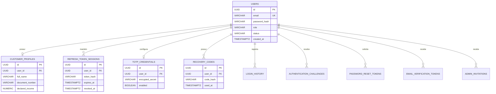
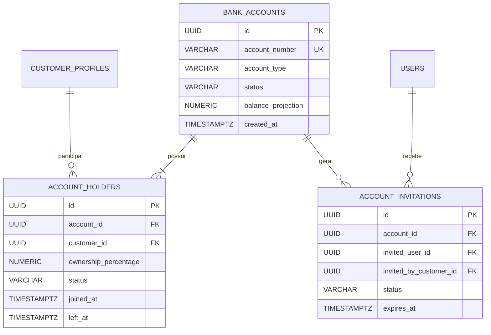
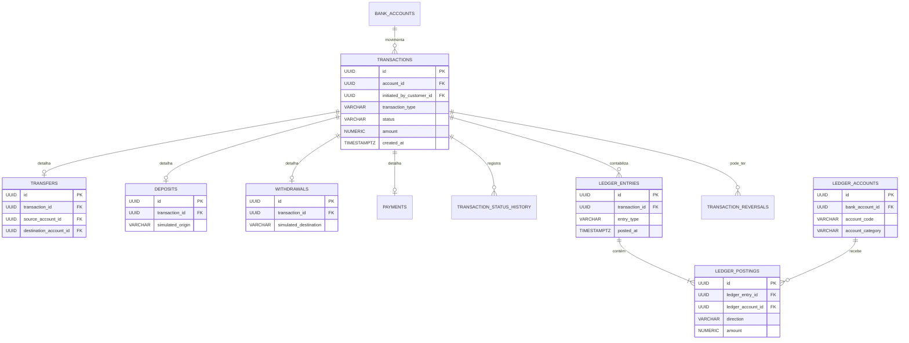
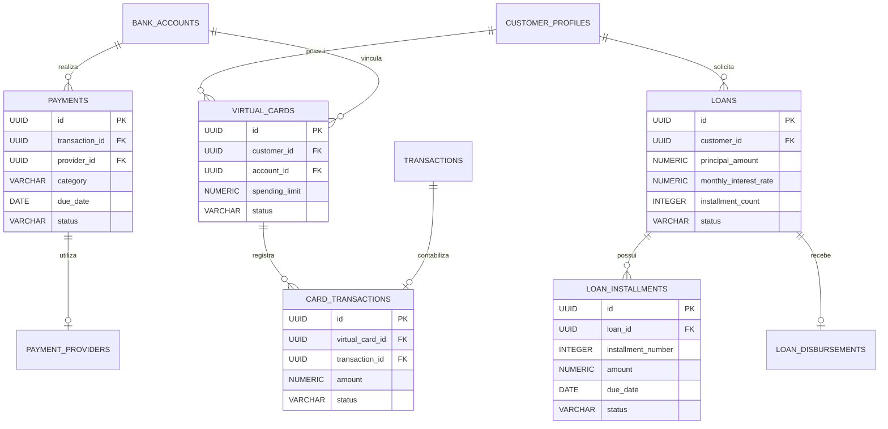
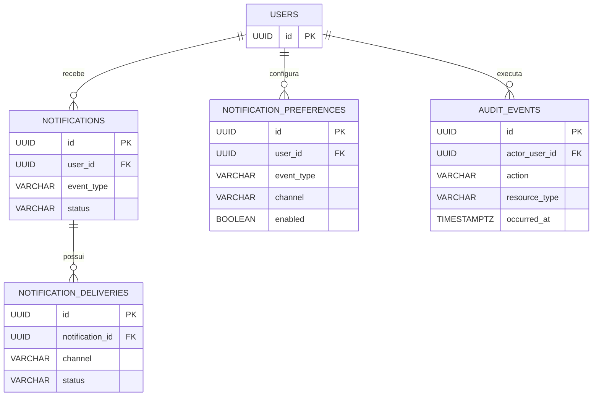

# MyBank — Documento de Modelagem do Banco de Dados
## Diagrama Entidade-Relacionamento (DER) e Dicionário de Dados

**Versão:** 1.0 — Proposta para revisão  
**Banco de dados:** PostgreSQL  
**Identificadores:** UUID  
**Moeda:** BRL  
**Precisão monetária:** `NUMERIC(19,2)`  
**Persistência:** Spring Data JPA  
**Migrações:** Flyway

---

# 1. Objetivo da modelagem

Definir a estrutura de persistência do MyBank, contemplando:

- Identidade, autenticação e segurança.
- Clientes, contas individuais e conjuntas.
- Titularidade, convites e encerramento de contas.
- Transações financeiras e histórico de estados.
- Ledger contábil com partidas dobradas.
- Depósitos, saques e transferências.
- Pagamentos simulados.
- Empréstimos e parcelas.
- Cartões virtuais.
- Notificações.
- Administração e auditoria.
- Privacidade, retenção e solicitações LGPD.
- Processamento assíncrono por eventos.

O banco deverá preservar a integridade financeira, rastreabilidade, consistência transacional e histórico das operações.

# 2. Convenções gerais

## 2.1. Tipos de dados

| Tipo | Utilização |
|---|---|
| `UUID` | Identificadores primários e relacionamentos |
| `VARCHAR(n)` | Textos com tamanho definido |
| `TEXT` | Textos extensos |
| `NUMERIC(19,2)` | Valores monetários em BRL |
| `NUMERIC(9,6)` | Taxas de juros |
| `NUMERIC(5,2)` | Percentuais de participação |
| `INTEGER` | Quantidades e contadores |
| `BOOLEAN` | Indicadores lógicos |
| `DATE` | Datas sem horário |
| `TIMESTAMPTZ` | Datas e horários com fuso |
| `JSONB` | Metadados estruturados e configurações flexíveis |

## 2.2. Convenções de nomenclatura

- Tabelas no plural e em `snake_case`.
- Colunas em `snake_case`.
- Chaves primárias com o nome `id`.
- Chaves estrangeiras identificadas pelo nome da entidade relacionada, seguido de `_id`.
- Datas de criação e atualização com `created_at` e `updated_at`, quando aplicáveis.
- Datas de exclusão lógica não serão adicionadas indiscriminadamente.
- Estados serão armazenados como valores controlados, preferencialmente com restrições `CHECK` ou tabelas de domínio quando houver necessidade de configuração.

## 2.3. Regras monetárias

- Todos os valores financeiros serão armazenados em `NUMERIC(19,2)`.
- No Java, será utilizado `BigDecimal`.
- Não utilizar `float` ou `double` para operações financeiras.
- A moeda será exclusivamente BRL.
- Não haverá tabelas de câmbio, moedas adicionais ou conversões.
- Valores de taxas e percentuais terão precisão própria, sem serem confundidos com valores monetários.

# 3. Diagrama Entidade-Relacionamento

O DER está dividido em grupos funcionais para facilitar a leitura. Os relacionamentos representam a estrutura lógica proposta, não substituindo as restrições detalhadas do banco.

## 3.1. Identidade, autenticação e clientes

## 3.2. Contas e titularidade

## 3.3. Transações e Ledger

## 3.4. Pagamentos, empréstimos e cartões

## 3.5. Notificações, auditoria e infraestrutura

# 4. Dicionário de dados

A seguir estão as tabelas propostas, seus campos e suas responsabilidades.

Legenda:

- **PK:** chave primária.
- **FK:** chave estrangeira.
- **UK:** restrição de unicidade.
- **NN:** campo obrigatório (`NOT NULL`).
- **NULL:** campo opcional.

## 4.1. Módulo Identity — Identidade e autenticação

### 4.1.1. `users`

Armazena as credenciais e a identidade de acesso ao sistema.

| Campo | Tipo | Regras |
|---|---|---|
| `id` | UUID | PK, NN |
| `email` | VARCHAR(254) | NN, UK, normalizado |
| `password_hash` | VARCHAR(255) | NN |
| `role` | VARCHAR(20) | NN, `CUSTOMER` ou `ADMIN` |
| `status` | VARCHAR(20) | NN, `PENDING`, `ACTIVE`, `BLOCKED`, `DISABLED` |
| `email_verified_at` | TIMESTAMPTZ | NULL |
| `last_login_at` | TIMESTAMPTZ | NULL |
| `created_at` | TIMESTAMPTZ | NN |
| `updated_at` | TIMESTAMPTZ | NN |

Regras:

- E-mail único, considerando normalização e comparação sem distinção entre maiúsculas e minúsculas.
- Senhas armazenadas com hash Argon2id, se essa tecnologia for confirmada na decisão de implementação.
- Nunca armazenar senhas em texto puro.
- `ADMIN` e `CUSTOMER` são os únicos perfis.
- Não existe perfil `SUPPORT`.

### 4.1.2. `customer_profiles`

Armazena informações pessoais dos clientes.

| Campo | Tipo | Regras |
|---|---|---|
| `id` | UUID | PK, NN |
| `user_id` | UUID | FK → `users.id`, NN, UK |
| `full_name` | VARCHAR(150) | NN |
| `document_number` | VARCHAR(20) | NN, UK |
| `phone_number` | VARCHAR(20) | NULL |
| `birth_date` | DATE | NULL |
| `declared_income` | NUMERIC(19,2) | NULL, maior ou igual a zero |
| `created_at` | TIMESTAMPTZ | NN |
| `updated_at` | TIMESTAMPTZ | NN |

Regras:

- Um usuário CUSTOMER possui, no máximo, um perfil de cliente.
- O documento deverá ser armazenado de forma protegida e seu acesso controlado.
- A renda é declarada pelo cliente e utilizada nas regras simuladas de empréstimo.
- O perfil não substitui a entidade de autenticação.

### 4.1.3. `refresh_token_sessions`

Controla sessões e refresh tokens.

| Campo | Tipo | Regras |
|---|---|---|
| `id` | UUID | PK |
| `user_id` | UUID | FK → `users.id`, NN |
| `token_hash` | VARCHAR(255) | NN, UK |
| `family_id` | UUID | NN |
| `created_at` | TIMESTAMPTZ | NN |
| `expires_at` | TIMESTAMPTZ | NN |
| `revoked_at` | TIMESTAMPTZ | NULL |
| `replaced_by_session_id` | UUID | FK → `refresh_token_sessions.id`, NULL |
| `ip_address` | VARCHAR(45) | NULL |
| `user_agent` | TEXT | NULL |

Regras:

- Armazenar hash, nunca o refresh token original.
- Rotação de tokens controlada transacionalmente.
- Reutilização de token revogado deve ser detectada.
- Logout revoga a sessão correspondente.
- Permitir encerramento de sessões por usuário e por administração autorizada.

### 4.1.4. `totp_credentials`

Armazena a configuração de autenticação TOTP.

| Campo | Tipo | Regras |
|---|---|---|
| `id` | UUID | PK |
| `user_id` | UUID | FK → `users.id`, NN, UK |
| `encrypted_secret` | TEXT | NN |
| `enabled` | BOOLEAN | NN |
| `confirmed_at` | TIMESTAMPTZ | NULL |
| `last_used_at` | TIMESTAMPTZ | NULL |
| `created_at` | TIMESTAMPTZ | NN |
| `updated_at` | TIMESTAMPTZ | NN |

Regras:

- O segredo TOTP deve ser criptografado.
- ADMIN deve possuir TOTP ativo para acessar o painel.
- CUSTOMER pode habilitar ou desabilitar 2FA conforme as regras de segurança.
- Desativação exige reautenticação.
- Não permitir desativação de 2FA para ADMIN.

### 4.1.5. `recovery_codes`

Armazena códigos de recuperação de uso único.

| Campo | Tipo | Regras |
|---|---|---|
| `id` | UUID | PK |
| `user_id` | UUID | FK → `users.id`, NN |
| `code_hash` | VARCHAR(255) | NN |
| `used_at` | TIMESTAMPTZ | NULL |
| `created_at` | TIMESTAMPTZ | NN |

Regras:

- Armazenar somente hashes.
- Cada código poderá ser utilizado uma única vez.
- Códigos utilizados não poderão ser reutilizados.

### 4.1.6. `login_history`

Histórico de tentativas e acessos.

| Campo | Tipo | Regras |
|---|---|---|
| `id` | UUID | PK |
| `user_id` | UUID | FK → `users.id`, NULL |
| `email_attempted` | VARCHAR(254) | NULL |
| `ip_address` | VARCHAR(45) | NULL |
| `user_agent` | TEXT | NULL |
| `success` | BOOLEAN | NN |
| `failure_reason` | VARCHAR(50) | NULL |
| `occurred_at` | TIMESTAMPTZ | NN |

Regras:

- Registrar tentativas bem-sucedidas e malsucedidas.
- Evitar armazenar dados sensíveis desnecessários.
- Utilizar os registros para investigação e alertas de segurança.

### 4.1.7. `authentication_challenges`

Controla desafios de autenticação adicional, inclusive a simulação de 2FA no ambiente de desenvolvimento.

| Campo | Tipo | Regras |
|---|---|---|
| `id` | UUID | PK |
| `user_id` | UUID | FK → `users.id`, NN |
| `challenge_type` | VARCHAR(30) | NN |
| `code_hash` | VARCHAR(255) | NULL |
| `status` | VARCHAR(20) | NN |
| `attempt_count` | INTEGER | NN, padrão 0 |
| `max_attempts` | INTEGER | NN |
| `expires_at` | TIMESTAMPTZ | NN |
| `consumed_at` | TIMESTAMPTZ | NULL |
| `created_at` | TIMESTAMPTZ | NN |

Regras:

- Código demonstrativo com seis dígitos, uso único e validade inicial proposta de dois minutos.
- Novo código invalida o anterior para o mesmo desafio.
- Tentativas limitadas.
- Código demonstrativo acessível exclusivamente pelo mecanismo de desenvolvimento.
- Não expor o código em respostas ou logs de produção.

### 4.1.8. `password_reset_tokens`

Controla solicitações de redefinição de senha.

| Campo | Tipo | Regras |
|---|---|---|
| `id` | UUID | PK |
| `user_id` | UUID | FK → `users.id`, NN |
| `token_hash` | VARCHAR(255) | NN, UK |
| `expires_at` | TIMESTAMPTZ | NN |
| `used_at` | TIMESTAMPTZ | NULL |
| `created_at` | TIMESTAMPTZ | NN |

### 4.1.9. `email_verification_tokens`

Controla a verificação de e-mail.

| Campo | Tipo | Regras |
|---|---|---|
| `id` | UUID | PK |
| `user_id` | UUID | FK → `users.id`, NN |
| `token_hash` | VARCHAR(255) | NN, UK |
| `expires_at` | TIMESTAMPTZ | NN |
| `used_at` | TIMESTAMPTZ | NULL |
| `created_at` | TIMESTAMPTZ | NN |

### 4.1.10. `admin_invitations`

Controla convites para criação de novos administradores.

| Campo | Tipo | Regras |
|---|---|---|
| `id` | UUID | PK |
| `email` | VARCHAR(254) | NN |
| `token_hash` | VARCHAR(255) | NN, UK |
| `invited_by_user_id` | UUID | FK → `users.id`, NN |
| `status` | VARCHAR(20) | NN |
| `expires_at` | TIMESTAMPTZ | NN |
| `accepted_at` | TIMESTAMPTZ | NULL |
| `created_at` | TIMESTAMPTZ | NN |

Regras:

- O convite possui validade limitada e uso único.
- O destinatário define sua própria senha.
- Todos os administradores possuem o mesmo nível de acesso.
- O primeiro administrador é provisionado durante o bootstrap.
- Não permitir desativação do último administrador ativo.

---

## 4.2. Módulo Account — Contas e titulares

### 4.2.1. `bank_accounts`

Representa contas bancárias individuais ou conjuntas.

| Campo | Tipo | Regras |
|---|---|---|
| `id` | UUID | PK |
| `account_number` | VARCHAR(9) | NN, UK |
| `account_type` | VARCHAR(20) | NN, `INDIVIDUAL` ou `JOINT` |
| `status` | VARCHAR(20) | NN |
| `balance_projection` | NUMERIC(19,2) | NN, padrão 0 |
| `opened_at` | TIMESTAMPTZ | NN |
| `closed_at` | TIMESTAMPTZ | NULL |
| `created_at` | TIMESTAMPTZ | NN |
| `updated_at` | TIMESTAMPTZ | NN |

Regras:

- Número de conta composto por nove dígitos, com oito dígitos identificadores e um dígito verificador.
- Gerado automaticamente pelo backend.
- Unicidade garantida pelo banco.
- UUID é o identificador interno.
- `balance_projection` é uma projeção para consulta, nunca a fonte contábil oficial.
- O saldo oficial é obtido a partir do Ledger.
- Conta encerrada não poderá ser reativada diretamente.

Estados sugeridos:

`PENDING`, `ACTIVE`, `BLOCKED`, `SUSPENDED`, `CLOSED`.

### 4.2.2. `account_holders`

Relaciona clientes às contas, mantendo o histórico de titularidade.

| Campo | Tipo | Regras |
|---|---|---|
| `id` | UUID | PK |
| `account_id` | UUID | FK → `bank_accounts.id`, NN |
| `customer_id` | UUID | FK → `customer_profiles.id`, NN |
| `ownership_percentage` | NUMERIC(5,2) | NULL |
| `status` | VARCHAR(20) | NN |
| `joined_at` | TIMESTAMPTZ | NN |
| `left_at` | TIMESTAMPTZ | NULL |
| `created_at` | TIMESTAMPTZ | NN |

Regras:

- Cliente participa de apenas uma conta ativa.
- Conta individual possui exatamente um titular ativo.
- Conta conjunta possui dois ou mais titulares ativos.
- Todos os titulares ativos possuem os mesmos direitos operacionais.
- Percentuais podem ser definidos ou permanecer indefinidos.
- Se definidos, todos os titulares ativos devem possuir percentual e a soma deve ser 100%.
- A saída de titular deve preservar o histórico.
- Não permitir remoção unilateral de titular.
- O histórico de titularidade não deve ser apagado.

A regra de uma conta ativa por cliente deverá ser garantida por índice único parcial ou mecanismo equivalente no PostgreSQL.

### 4.2.3. `account_invitations`

Controla convites para ingresso em contas conjuntas.

| Campo | Tipo | Regras |
|---|---|---|
| `id` | UUID | PK |
| `account_id` | UUID | FK → `bank_accounts.id`, NN |
| `invited_user_id` | UUID | FK → `users.id`, NN |
| `invited_by_customer_id` | UUID | FK → `customer_profiles.id`, NN |
| `status` | VARCHAR(20) | NN |
| `expires_at` | TIMESTAMPTZ | NN |
| `accepted_at` | TIMESTAMPTZ | NULL |
| `cancelled_at` | TIMESTAMPTZ | NULL |
| `created_at` | TIMESTAMPTZ | NN |

Regras:

- Apenas usuário já cadastrado pode ser convidado.
- Convite somente pode ser aceito pelo destinatário autenticado.
- Backend verifica se o destinatário já participa de outra conta.
- Convite possui validade limitada.
- Convites podem ser cancelados pelo criador ou ADMIN.
- Estados: `PENDING`, `ACCEPTED`, `EXPIRED`, `CANCELLED`.

---

## 4.3. Módulo Transaction — Operações financeiras

### 4.3.1. `transactions`

Entidade central de operações financeiras.

| Campo | Tipo | Regras |
|---|---|---|
| `id` | UUID | PK |
| `account_id` | UUID | FK → `bank_accounts.id`, NULL quando aplicável |
| `initiated_by_customer_id` | UUID | FK → `customer_profiles.id`, NULL para operações sistêmicas |
| `transaction_type` | VARCHAR(30) | NN |
| `status` | VARCHAR(20) | NN |
| `amount` | NUMERIC(19,2) | NN, maior que zero |
| `description` | VARCHAR(255) | NULL |
| `reference_code` | VARCHAR(100) | NULL, UK quando informado |
| `created_at` | TIMESTAMPTZ | NN |
| `updated_at` | TIMESTAMPTZ | NN |
| `completed_at` | TIMESTAMPTZ | NULL |

Tipos sugeridos:

`TRANSFER`, `DEPOSIT`, `WITHDRAWAL`, `PAYMENT`, `LOAN_DISBURSEMENT`, `CARD_PURCHASE`, `CARD_REFUND`, `REVERSAL`.

Estados:

`PENDING`, `PROCESSING`, `COMPLETED`, `REJECTED`, `FAILED`, `CANCELLED`.

Regras:

- A transação representa a operação de negócio.
- Os detalhes específicos ficam nas tabelas especializadas.
- Toda operação contabilizada deve possuir lançamentos correspondentes no Ledger.
- Operações financeiras devem ser idempotentes.
- Operações contabilizadas não podem ser apagadas ou editadas diretamente.

### 4.3.2. `transfers`

Detalha transferências entre contas MyBank.

| Campo | Tipo | Regras |
|---|---|---|
| `id` | UUID | PK |
| `transaction_id` | UUID | FK → `transactions.id`, NN, UK |
| `source_account_id` | UUID | FK → `bank_accounts.id`, NN |
| `destination_account_id` | UUID | FK → `bank_accounts.id`, NN |
| `recipient_description` | VARCHAR(150) | NULL |

Regras:

- Origem e destino devem ser diferentes.
- Ambas as contas devem estar aptas a operar.
- A conta de origem precisa ter saldo suficiente no processamento.
- A titularidade e as permissões devem ser validadas no backend.
- Transferências são exclusivamente internas ao MyBank.

### 4.3.3. `deposits`

Detalha depósitos simulados.

| Campo | Tipo | Regras |
|---|---|---|
| `id` | UUID | PK |
| `transaction_id` | UUID | FK → `transactions.id`, NN, UK |
| `simulated_origin` | VARCHAR(100) | NN |
| `origin_reference` | VARCHAR(100) | NULL |

Regras:

- Depósito utiliza uma conta contábil de compensação.
- A entrada no saldo do cliente possui contrapartida contábil.
- Não existe integração bancária externa.

### 4.3.4. `withdrawals`

Detalha saques simulados.

| Campo | Tipo | Regras |
|---|---|---|
| `id` | UUID | PK |
| `transaction_id` | UUID | FK → `transactions.id`, NN, UK |
| `simulated_destination` | VARCHAR(100) | NN |
| `destination_reference` | VARCHAR(100) | NULL |

Regras:

- Saque utiliza uma conta contábil de compensação.
- O débito na conta do cliente deve possuir contrapartida contábil.
- Saldo deve ser validado durante o processamento.

### 4.3.5. `transaction_status_history`

Registra as mudanças de estado das operações.

| Campo | Tipo | Regras |
|---|---|---|
| `id` | UUID | PK |
| `transaction_id` | UUID | FK → `transactions.id`, NN |
| `previous_status` | VARCHAR(20) | NULL |
| `new_status` | VARCHAR(20) | NN |
| `changed_by_user_id` | UUID | FK → `users.id`, NULL |
| `reason` | TEXT | NULL |
| `created_at` | TIMESTAMPTZ | NN |

Regras:

- Registrar cada transição.
- Estados finais não devem ser reabertos.
- Alterações devem respeitar a máquina de estados.

### 4.3.6. `transaction_reversals`

Registra estornos e operações compensatórias.

| Campo | Tipo | Regras |
|---|---|---|
| `id` | UUID | PK |
| `original_transaction_id` | UUID | FK → `transactions.id`, NN |
| `reversal_transaction_id` | UUID | FK → `transactions.id`, NN, UK |
| `requested_by_user_id` | UUID | FK → `users.id`, NN |
| `reason` | TEXT | NN |
| `created_at` | TIMESTAMPTZ | NN |

Regras:

- Não modificar lançamentos contabilizados.
- Estorno deve gerar nova operação e novos lançamentos.
- Registrar motivo e responsável.
- Impedir estornos duplicados indevidos.

### 4.3.7. `idempotency_records`

Controla duplicidade de requisições financeiras.

| Campo | Tipo | Regras |
|---|---|---|
| `id` | UUID | PK |
| `idempotency_key` | VARCHAR(150) | NN |
| `user_id` | UUID | FK → `users.id`, NN |
| `operation_type` | VARCHAR(50) | NN |
| `request_hash` | VARCHAR(255) | NN |
| `transaction_id` | UUID | FK → `transactions.id`, NULL |
| `response_snapshot` | JSONB | NULL |
| `created_at` | TIMESTAMPTZ | NN |
| `expires_at` | TIMESTAMPTZ | NN |

Regras:

- Unicidade da chave por usuário e operação.
- Requisições repetidas com a mesma chave não podem executar novamente a operação.
- A mesma chave com conteúdo diferente deve ser rejeitada.
- A política de retenção deve impedir que uma chave ainda necessária seja removida prematuramente.

---

## 4.4. Módulo Ledger — Contabilidade

### 4.4.1. `ledger_accounts`

Representa contas contábeis internas.

| Campo | Tipo | Regras |
|---|---|---|
| `id` | UUID | PK |
| `bank_account_id` | UUID | FK → `bank_accounts.id`, NULL, UK quando informado |
| `account_code` | VARCHAR(50) | NN, UK |
| `account_name` | VARCHAR(120) | NN |
| `account_category` | VARCHAR(30) | NN |
| `normal_balance` | VARCHAR(10) | NN |
| `status` | VARCHAR(20) | NN |
| `created_at` | TIMESTAMPTZ | NN |

Categorias contábeis sugeridas:

`ASSET`, `LIABILITY`, `EQUITY`, `REVENUE`, `EXPENSE`.

Regras:

- Contas de clientes devem estar vinculadas à respectiva conta bancária.
- Contas de compensação representam origens e destinos simulados.
- Contas contábeis não devem ser removidas quando possuírem lançamentos históricos.

### 4.4.2. `ledger_entries`

Representa um conjunto de lançamentos contábeis de uma operação.

| Campo | Tipo | Regras |
|---|---|---|
| `id` | UUID | PK |
| `transaction_id` | UUID | FK → `transactions.id`, NN |
| `entry_type` | VARCHAR(30) | NN |
| `description` | VARCHAR(255) | NULL |
| `posted_at` | TIMESTAMPTZ | NN |
| `created_at` | TIMESTAMPTZ | NN |

Regras:

- Um lançamento contabilizado é imutável.
- Cada conjunto contábil deve possuir débitos e créditos equilibrados.
- Uma transação pode gerar mais de um conjunto de lançamentos, por exemplo, quando houver estorno ou ajuste.

### 4.4.3. `ledger_postings`

Armazena os débitos e créditos individuais.

| Campo | Tipo | Regras |
|---|---|---|
| `id` | UUID | PK |
| `ledger_entry_id` | UUID | FK → `ledger_entries.id`, NN |
| `ledger_account_id` | UUID | FK → `ledger_accounts.id`, NN |
| `direction` | VARCHAR(10) | NN, `DEBIT` ou `CREDIT` |
| `amount` | NUMERIC(19,2) | NN, maior que zero |
| `created_at` | TIMESTAMPTZ | NN |

Regras:

- Soma dos débitos deve ser igual à soma dos créditos em cada conjunto contábil.
- Não permitir alteração ou exclusão de lançamentos contabilizados.
- Correções devem utilizar novas operações compensatórias.
- O equilíbrio contábil deve ser validado na mesma transação que grava os lançamentos.

### 4.4.4. Projeção de saldo

A coluna `bank_accounts.balance_projection` é uma projeção de leitura do saldo contábil.

Regras:

- Atualizada na mesma transação que registra os lançamentos.
- Se qualquer parte da operação falhar, toda a transação deve ser revertida.
- Deve existir rotina de reconciliação entre a projeção e o Ledger.
- O Ledger permanece como fonte oficial do saldo.
- Operações pendentes não reservam valores nem reduzem o saldo disponível.

---

## 4.5. Módulo Payment — Pagamentos simulados

### 4.5.1. `payment_providers`

Representa empresas fictícias que recebem pagamentos.

| Campo | Tipo | Regras |
|---|---|---|
| `id` | UUID | PK |
| `name` | VARCHAR(120) | NN |
| `category` | VARCHAR(30) | NN |
| `simulated_code_prefix` | VARCHAR(30) | NULL |
| `status` | VARCHAR(20) | NN |
| `created_at` | TIMESTAMPTZ | NN |

Categorias:

`WATER`, `ENERGY`, `INTERNET`, `TELEPHONY`, `GAS`, `OTHER`.

### 4.5.2. `payments`

Detalha os pagamentos de contas fictícias.

| Campo | Tipo | Regras |
|---|---|---|
| `id` | UUID | PK |
| `transaction_id` | UUID | FK → `transactions.id`, NN, UK |
| `provider_id` | UUID | FK → `payment_providers.id`, NN |
| `simulated_barcode` | VARCHAR(120) | NULL |
| `description` | VARCHAR(255) | NULL |
| `due_date` | DATE | NULL |
| `scheduled_at` | TIMESTAMPTZ | NULL |
| `paid_at` | TIMESTAMPTZ | NULL |
| `status` | VARCHAR(20) | NN |
| `created_at` | TIMESTAMPTZ | NN |

Estados:

`PENDING`, `SCHEDULED`, `PROCESSING`, `COMPLETED`, `REJECTED`, `FAILED`, `CANCELLED`.

Regras:

- Pagamentos são exclusivamente simulados.
- Não existe integração com concessionárias ou instituições externas.
- Não são transferências entre usuários.
- Pagamentos agendados não reservam saldo antecipadamente.
- No processamento, o saldo deve ser validado novamente.

---

## 4.6. Módulo Loan — Empréstimos

### 4.6.1. `loans`

Armazena solicitações e contratos de empréstimo.

| Campo | Tipo | Regras |
|---|---|---|
| `id` | UUID | PK |
| `customer_id` | UUID | FK → `customer_profiles.id`, NN |
| `principal_amount` | NUMERIC(19,2) | NN |
| `monthly_interest_rate` | NUMERIC(9,6) | NN |
| `installment_count` | INTEGER | NN |
| `installment_amount` | NUMERIC(19,2) | NULL |
| `total_amount` | NUMERIC(19,2) | NULL |
| `amortization_method` | VARCHAR(20) | NN, `PRICE` |
| `declared_income_snapshot` | NUMERIC(19,2) | NN |
| `committed_income_percentage` | NUMERIC(5,2) | NN |
| `approved_by_user_id` | UUID | FK → `users.id`, NULL |
| `approval_reason` | TEXT | NULL |
| `requested_at` | TIMESTAMPTZ | NN |
| `approved_at` | TIMESTAMPTZ | NULL |
| `contracted_at` | TIMESTAMPTZ | NULL |
| `expires_at` | TIMESTAMPTZ | NULL |
| `status` | VARCHAR(20) | NN |
| `created_at` | TIMESTAMPTZ | NN |
| `updated_at` | TIMESTAMPTZ | NN |

Estados:

`REQUESTED`, `UNDER_REVIEW`, `APPROVED`, `REJECTED`, `CONTRACTED`, `ACTIVE`, `PAID_OFF`, `CANCELLED`.

Regras:

- Sistema de amortização Price.
- Taxa de juros mensal.
- Condições aprovadas devem ser armazenadas como snapshot.
- Alterações futuras nas configurações não modificam contratos existentes.
- Comprometimento de renda inicial proposto de 30%, configurável.
- A análise considera renda declarada, empréstimos ativos e capacidade de pagamento simulada.
- Aprovação manual exige justificativa e auditoria.
- Oferta aprovada deve possuir validade definida.
- Empréstimos simultâneos respeitam limites e concorrência.
- A liberação do valor gera operação financeira e lançamentos no Ledger.

### 4.6.2. `loan_installments`

Armazena parcelas dos empréstimos.

| Campo | Tipo | Regras |
|---|---|---|
| `id` | UUID | PK |
| `loan_id` | UUID | FK → `loans.id`, NN |
| `installment_number` | INTEGER | NN |
| `principal_component` | NUMERIC(19,2) | NN |
| `interest_component` | NUMERIC(19,2) | NN |
| `amount` | NUMERIC(19,2) | NN |
| `due_date` | DATE | NN |
| `paid_at` | TIMESTAMPTZ | NULL |
| `status` | VARCHAR(20) | NN |
| `created_at` | TIMESTAMPTZ | NN |

Estados:

`PENDING`, `PAID`, `OVERDUE`, `CANCELLED`.

Regras:

- Número da parcela único por empréstimo.
- A parcela vencida poderá ser paga.
- O pagamento deve atualizar a obrigação e gerar a operação contábil correspondente.
- Empréstimo somente poderá ser considerado quitado quando todas as obrigações estiverem liquidadas.

### 4.6.3. `loan_disbursements`

Registra a liberação do valor do empréstimo.

| Campo | Tipo | Regras |
|---|---|---|
| `id` | UUID | PK |
| `loan_id` | UUID | FK → `loans.id`, NN, UK |
| `transaction_id` | UUID | FK → `transactions.id`, NN, UK |
| `disbursed_at` | TIMESTAMPTZ | NN |

Regras:

- A liberação é simulada.
- A operação deve ser contabilizada no Ledger.
- A mudança para empréstimo ativo deve ser coerente com a conclusão da liberação.
- Não liberar valores sem contrapartida contábil.

---

## 4.7. Módulo Card — Cartões virtuais

### 4.7.1. `virtual_cards`

Armazena cartões virtuais demonstrativos.

| Campo | Tipo | Regras |
|---|---|---|
| `id` | UUID | PK |
| `customer_id` | UUID | FK → `customer_profiles.id`, NN |
| `account_id` | UUID | FK → `bank_accounts.id`, NN |
| `display_number` | VARCHAR(19) | NN |
| `cardholder_name` | VARCHAR(150) | NN |
| `expiration_month` | INTEGER | NN |
| `expiration_year` | INTEGER | NN |
| `spending_limit` | NUMERIC(19,2) | NN |
| `spent_amount` | NUMERIC(19,2) | NN, padrão 0 |
| `status` | VARCHAR(20) | NN |
| `created_at` | TIMESTAMPTZ | NN |
| `updated_at` | TIMESTAMPTZ | NN |
| `cancelled_at` | TIMESTAMPTZ | NULL |

Estados:

`ACTIVE`, `BLOCKED`, `CANCELLED`.

Regras:

- Cartões são virtuais e fictícios.
- Não possuem bandeira nem integração com compras reais.
- Limite é de gasto, não linha de crédito.
- Compras simuladas debitam diretamente a conta bancária.
- Cartão bloqueado não pode realizar novas compras.
- Cartão cancelado não pode ser reativado.
- Compras precisam respeitar saldo disponível e limite restante.
- Titular deve continuar ativo na conta vinculada.
- Dados de segurança de cartão não devem ser armazenados desnecessariamente.

### 4.7.2. `card_transactions`

Registra compras e estornos realizados com cartões.

| Campo | Tipo | Regras |
|---|---|---|
| `id` | UUID | PK |
| `virtual_card_id` | UUID | FK → `virtual_cards.id`, NN |
| `transaction_id` | UUID | FK → `transactions.id`, NN, UK |
| `merchant_name` | VARCHAR(120) | NN |
| `operation_type` | VARCHAR(20) | NN |
| `amount` | NUMERIC(19,2) | NN |
| `status` | VARCHAR(20) | NN |
| `created_at` | TIMESTAMPTZ | NN |

Regras:

- Compras e estornos são simulados.
- A movimentação financeira correspondente deve estar registrada no Ledger.
- Estornos recompõem saldo e limite de gasto, conforme a operação original.
- A atualização de saldo e limite deve ser atômica.

---

## 4.8. Módulo Notification — Notificações

### 4.8.1. `notifications`

Armazena notificações destinadas aos usuários.

| Campo | Tipo | Regras |
|---|---|---|
| `id` | UUID | PK |
| `user_id` | UUID | FK → `users.id`, NN |
| `event_type` | VARCHAR(50) | NN |
| `title` | VARCHAR(150) | NN |
| `message` | TEXT | NN |
| `status` | VARCHAR(20) | NN |
| `read_at` | TIMESTAMPTZ | NULL |
| `created_at` | TIMESTAMPTZ | NN |

### 4.8.2. `notification_preferences`

Armazena preferências de recebimento.

| Campo | Tipo | Regras |
|---|---|---|
| `id` | UUID | PK |
| `user_id` | UUID | FK → `users.id`, NN |
| `event_type` | VARCHAR(50) | NN |
| `channel` | VARCHAR(20) | NN |
| `enabled` | BOOLEAN | NN |
| `created_at` | TIMESTAMPTZ | NN |
| `updated_at` | TIMESTAMPTZ | NN |

Canais:

`IN_APP`, `EMAIL`, `PUSH`.

Regra de unicidade: usuário + evento + canal.

### 4.8.3. `notification_deliveries`

Controla tentativas de entrega.

| Campo | Tipo | Regras |
|---|---|---|
| `id` | UUID | PK |
| `notification_id` | UUID | FK → `notifications.id`, NN |
| `channel` | VARCHAR(20) | NN |
| `status` | VARCHAR(20) | NN |
| `attempt_count` | INTEGER | NN, padrão 0 |
| `last_attempt_at` | TIMESTAMPTZ | NULL |
| `delivered_at` | TIMESTAMPTZ | NULL |
| `failure_reason` | TEXT | NULL |
| `created_at` | TIMESTAMPTZ | NN |

Regras:

- E-mail será simulado no ambiente de desenvolvimento.
- Push utilizará a API de notificações do navegador, com autorização do usuário.
- Não incluir dados financeiros sensíveis desnecessários.
- Controlar tentativas e evitar notificações duplicadas.

---

## 4.9. Módulo Admin e Audit — Administração e auditoria

### 4.9.1. `audit_events`

Registra ações administrativas e eventos sensíveis de negócio.

| Campo | Tipo | Regras |
|---|---|---|
| `id` | UUID | PK |
| `actor_user_id` | UUID | FK → `users.id`, NULL para eventos sistêmicos |
| `action` | VARCHAR(100) | NN |
| `resource_type` | VARCHAR(80) | NN |
| `resource_id` | UUID | NULL |
| `reason` | TEXT | NULL |
| `before_data` | JSONB | NULL |
| `after_data` | JSONB | NULL |
| `ip_address` | VARCHAR(45) | NULL |
| `user_agent` | TEXT | NULL |
| `occurred_at` | TIMESTAMPTZ | NN |

Regras:

- Justificativa obrigatória nas ações administrativas sensíveis e críticas.
- Consultas sensíveis também devem ser auditadas.
- Auditoria não deve ser editável por operações administrativas comuns.
- Não armazenar senhas, tokens ou segredos.
- Alterações de dados pessoais devem evitar cópias desnecessárias de informações sensíveis em `before_data` e `after_data`.
- Não existe segunda aprovação administrativa.

### 4.9.2. `system_settings`

Armazena parâmetros de configuração do sistema.

| Campo | Tipo | Regras |
|---|---|---|
| `id` | UUID | PK |
| `setting_key` | VARCHAR(100) | NN, UK |
| `setting_value` | JSONB | NN |
| `description` | TEXT | NULL |
| `updated_by_user_id` | UUID | FK → `users.id`, NULL |
| `created_at` | TIMESTAMPTZ | NN |
| `updated_at` | TIMESTAMPTZ | NN |

Exemplos de parâmetros:

- Taxa de juros de empréstimos.
- Comprometimento máximo de renda.
- Valor mínimo e máximo de empréstimos.
- Prazo máximo de empréstimos.
- Validade de convites.
- Limites de tentativas de autenticação.
- Configurações de notificações.

Regras:

- Alterações críticas exigem justificativa e auditoria.
- Valores devem ser validados por tipo e faixa permitida.
- Segredos e credenciais não devem ser armazenados como configurações comuns.

---

## 4.10. Infraestrutura — Eventos assíncronos

### 4.10.1. `outbox_events`

Implementa o padrão Transactional Outbox.

| Campo | Tipo | Regras |
|---|---|---|
| `id` | UUID | PK |
| `aggregate_type` | VARCHAR(80) | NN |
| `aggregate_id` | UUID | NN |
| `event_type` | VARCHAR(100) | NN |
| `payload` | JSONB | NN |
| `status` | VARCHAR(20) | NN |
| `attempt_count` | INTEGER | NN, padrão 0 |
| `created_at` | TIMESTAMPTZ | NN |
| `processed_at` | TIMESTAMPTZ | NULL |
| `next_attempt_at` | TIMESTAMPTZ | NULL |
| `last_error` | TEXT | NULL |

Estados sugeridos:

`PENDING`, `PROCESSING`, `PROCESSED`, `FAILED`.

Regras:

- Evento deve ser gravado na mesma transação da operação de negócio correspondente.
- Processamento assíncrono não deve comprometer a consistência financeira.
- Consumidores devem ser idempotentes.
- Tentativas devem ser limitadas.
- Falhas devem ser registradas.
- Não utilizar Kafka ou RabbitMQ inicialmente.

---

## 4.11. Privacidade — LGPD e retenção

### 4.11.1. `data_subject_requests`

Registra solicitações dos titulares de dados pessoais.

| Campo | Tipo | Regras |
|---|---|---|
| `id` | UUID | PK |
| `user_id` | UUID | FK → `users.id`, NULL quando anonimizado |
| `request_type` | VARCHAR(40) | NN |
| `status` | VARCHAR(20) | NN |
| `description` | TEXT | NULL |
| `received_at` | TIMESTAMPTZ | NN |
| `completed_at` | TIMESTAMPTZ | NULL |
| `resolution_notes` | TEXT | NULL |

Tipos sugeridos:

`ACCESS`, `CORRECTION`, `ANONYMIZATION`, `DELETION`, `PORTABILITY`, `OTHER`.

Regras:

- Registrar e acompanhar solicitações.
- Não excluir registros financeiros cuja preservação seja necessária.
- Anonimizar ou eliminar dados pessoais quando aplicável.
- Avaliar cada solicitação conforme finalidade, base legal e obrigação de retenção.

### 4.11.2. `data_retention_policies`

Define políticas de retenção por categoria de informação.

| Campo | Tipo | Regras |
|---|---|---|
| `id` | UUID | PK |
| `data_category` | VARCHAR(80) | NN |
| `retention_period_days` | INTEGER | NULL |
| `legal_basis` | VARCHAR(150) | NULL |
| `description` | TEXT | NULL |
| `active` | BOOLEAN | NN |
| `created_at` | TIMESTAMPTZ | NN |
| `updated_at` | TIMESTAMPTZ | NN |

Regras:

- Não estabelecer prazos legais sem validação.
- Política deve ser documentada e revisável.
- Retenção de dados pessoais deve ser separada da preservação do histórico contábil.

# 5. Restrições, índices e integridade

## 5.1. Restrições obrigatórias

| Entidade | Restrição |
|---|---|
| `users` | E-mail único e normalizado |
| `customer_profiles` | Um perfil por usuário e documento único |
| `bank_accounts` | Número de conta único |
| `account_holders` | Um vínculo ativo por cliente |
| `account_holders` | Percentuais válidos entre 0 e 100 |
| `transfers` | Conta de origem diferente da conta de destino |
| `transactions` | Valor maior que zero |
| `ledger_postings` | Valor maior que zero |
| `ledger_postings` | Direção somente `DEBIT` ou `CREDIT` |
| `loan_installments` | Parcela única por empréstimo e número |
| `virtual_cards` | Limite de gasto não negativo |
| `notification_preferences` | Usuário, evento e canal únicos |
| `idempotency_records` | Chave única por usuário e operação |
| `account_invitations` | Convite válido e de uso único |
| `admin_invitations` | Convite válido e de uso único |

## 5.2. Regras que exigem validação transacional

Algumas regras não podem ser garantidas apenas por uma restrição `CHECK` convencional:

1. Conta individual deve possuir exatamente um titular ativo.
2. Conta conjunta deve possuir no mínimo dois titulares ativos.
3. Percentuais definidos devem somar 100%.
4. Cliente não pode possuir duas contas ativas.
5. Débitos e créditos devem estar equilibrados.
6. Saldo não pode ficar negativo.
7. Limite de gasto do cartão não pode ser ultrapassado.
8. Comprometimento de renda não pode ultrapassar o limite configurado.
9. Conta não pode ser encerrada com saldo positivo ou operações pendentes.
10. Encerramento de conta conjunta exige consentimento de todos os titulares ativos.

Essas regras deverão ser implementadas no domínio e na camada de aplicação, com transações e bloqueios apropriados. Quando adequado, poderão ser complementadas por índices parciais, triggers ou constraints diferíveis.

## 5.3. Índices recomendados

| Tabela | Índice |
|---|---|
| `users` | E-mail normalizado |
| `customer_profiles` | Documento |
| `refresh_token_sessions` | Usuário, expiração e revogação |
| `login_history` | Usuário e data |
| `bank_accounts` | Número da conta |
| `account_holders` | Cliente e estado ativo |
| `account_holders` | Conta e estado ativo |
| `account_invitations` | Destinatário e estado |
| `transactions` | Conta e data de criação |
| `transactions` | Estado e data de criação |
| `transfers` | Conta de origem e destino |
| `transaction_status_history` | Transação e data |
| `ledger_entries` | Transação |
| `ledger_postings` | Conta contábil e lançamento |
| `payments` | Estado e data agendada |
| `loans` | Cliente e estado |
| `loan_installments` | Empréstimo e vencimento |
| `virtual_cards` | Cliente e conta |
| `notifications` | Usuário e data |
| `notification_deliveries` | Estado e próxima tentativa |
| `audit_events` | Ator, recurso e data |
| `outbox_events` | Estado e próxima tentativa |

Índices compostos e parciais deverão ser definidos conforme as consultas reais e os planos de execução.

# 6. Máquinas de estados

As transições serão validadas na camada de domínio e registradas no histórico correspondente.

## 6.1. Transações

- `PENDING` → `PROCESSING`, `CANCELLED`, `REJECTED`.
- `PROCESSING` → `COMPLETED`, `FAILED`, `REJECTED`.
- Estados finais não podem retornar para estados anteriores.
- Estorno cria uma nova transação.

## 6.2. Pagamentos

- `PENDING` → `SCHEDULED`, `PROCESSING`, `CANCELLED`.
- `SCHEDULED` → `PROCESSING`, `CANCELLED`.
- `PROCESSING` → `COMPLETED`, `FAILED`, `REJECTED`.

## 6.3. Empréstimos

- `REQUESTED` → `UNDER_REVIEW`, `REJECTED`, `CANCELLED`.
- `UNDER_REVIEW` → `APPROVED`, `REJECTED`.
- `APPROVED` → `CONTRACTED`, `CANCELLED`.
- `CONTRACTED` → `ACTIVE`.
- `ACTIVE` → `PAID_OFF`.

A oferta aprovada deverá possuir validade. O contrato somente será considerado ativo após a liberação bem-sucedida do empréstimo.

## 6.4. Convites

- `PENDING` → `ACCEPTED`, `EXPIRED`, `CANCELLED`.

## 6.5. Cartões

- `ACTIVE` → `BLOCKED`, `CANCELLED`.
- `BLOCKED` → `ACTIVE`, `CANCELLED`.
- `CANCELLED` não possui retorno.

## 6.6. Parcelas

- `PENDING` → `PAID`, `OVERDUE`, `CANCELLED`.
- `OVERDUE` → `PAID`.

# 7. Regras de consistência financeira

## 7.1. Partidas dobradas

Cada operação contabilizada deverá produzir lançamentos equivalentes a débito e crédito.

Exemplo de transferência de R$ 100,00:

| Conta contábil | Direção | Valor |
|---|---|---:|
| Conta bancária de origem | DEBIT | R$ 100,00 |
| Conta bancária de destino | CREDIT | R$ 100,00 |

Os valores devem permanecer equilibrados dentro do conjunto de lançamentos.

## 7.2. Depósitos e saques

Depósito simulado de R$ 100,00:

| Conta contábil | Direção | Valor |
|---|---|---:|
| Compensação de depósitos | DEBIT | R$ 100,00 |
| Conta bancária do cliente | CREDIT | R$ 100,00 |

Saque simulado de R$ 100,00:

| Conta contábil | Direção | Valor |
|---|---|---:|
| Conta bancária do cliente | DEBIT | R$ 100,00 |
| Compensação de saques | CREDIT | R$ 100,00 |

## 7.3. Operações pendentes

- Operações pendentes não reservam saldo.
- O saldo disponível representa o saldo contábil efetivamente registrado.
- O backend revalida saldo, conta e permissões no processamento.
- Operações concorrentes deverão utilizar bloqueios adequados.
- O processamento deverá ser atômico.

## 7.4. Cartões

- Compra simulada debita a conta bancária.
- Compra consome o limite de gasto.
- Estorno recompõe saldo e limite.
- Atualização de saldo e limite deve ocorrer na mesma transação.
- Não existe crédito rotativo ou linha de crédito de cartão.

## 7.5. Empréstimos

- Liberação aumenta o saldo do cliente com contrapartida contábil.
- Parcelas registram principal e juros.
- Pagamento reduz a obrigação e produz lançamentos contábeis.
- A quitação depende da liquidação de todas as obrigações.

# 8. Estratégia de preservação dos dados

O sistema utilizará preservação histórica e exclusão controlada.

- Transações contabilizadas não serão apagadas.
- Lançamentos do Ledger não serão apagados.
- Auditoria não será removida por operações administrativas comuns.
- Contas encerradas permanecem no histórico.
- Titulares removidos ou que saíram permanecem registrados.
- Cartões cancelados permanecem no histórico.
- Empréstimos e obrigações financeiras não desaparecem com o encerramento da conta.
- Dados pessoais poderão ser anonimizados ou eliminados quando permitido.
- Solicitações de titulares serão registradas e acompanhadas.

Não será utilizado um campo genérico `deleted` em todas as tabelas.

# 9. Organização por módulos

| Módulo | Tabelas |
|---|---|
| Identity | `users`, `customer_profiles`, `refresh_token_sessions`, `totp_credentials`, `recovery_codes`, `login_history`, `authentication_challenges`, `password_reset_tokens`, `email_verification_tokens`, `admin_invitations` |
| Account | `bank_accounts`, `account_holders`, `account_invitations` |
| Transaction | `transactions`, `transfers`, `deposits`, `withdrawals`, `transaction_status_history`, `transaction_reversals`, `idempotency_records` |
| Ledger | `ledger_accounts`, `ledger_entries`, `ledger_postings` |
| Payment | `payment_providers`, `payments` |
| Loan | `loans`, `loan_installments`, `loan_disbursements` |
| Card | `virtual_cards`, `card_transactions` |
| Notification | `notifications`, `notification_preferences`, `notification_deliveries` |
| Admin / Audit | `audit_events`, `system_settings` |
| Infrastructure | `outbox_events` |
| Privacy | `data_subject_requests`, `data_retention_policies` |

# 10. Migrações Flyway

A criação física deverá ser dividida em migrações versionadas.

Proposta inicial:

| Migração | Conteúdo |
|---|---|
| V001 | Estrutura inicial e extensões necessárias |
| V002 | Identity e autenticação |
| V003 | Clientes e perfis |
| V004 | Contas e titulares |
| V005 | Convites e titularidade conjunta |
| V006 | Transações e idempotência |
| V007 | Ledger e contas contábeis |
| V008 | Depósitos, saques e transferências |
| V009 | Pagamentos |
| V010 | Empréstimos e parcelas |
| V011 | Cartões virtuais |
| V012 | Notificações |
| V013 | Administração e auditoria |
| V014 | Outbox e configurações |
| V015 | Privacidade e retenção |
| V016 | Índices adicionais e integridade complementar |

A ordem poderá ser ajustada conforme as dependências reais das entidades.

Migrações aplicadas não deverão ser editadas retroativamente em ambientes compartilhados. Correções deverão ser realizadas em novas migrações.

# 11. Pontos técnicos que exigem atenção durante a implementação

1. **Saldo e Ledger:** o saldo projetado deve ser atualizado atomicamente com os lançamentos contábeis.
2. **Concorrência:** transferências, saques, compras e pagamentos precisam impedir gasto duplicado do mesmo saldo.
3. **Titularidade:** a regra de uma conta ativa por cliente exige restrição adequada no banco.
4. **Percentuais conjuntos:** consistência entre os percentuais deve ser validada transacionalmente.
5. **Estornos:** devem gerar novos lançamentos, sem modificar registros históricos.
6. **Idempotência:** requisições financeiras repetidas não podem gerar duplicidade.
7. **Outbox:** eventos devem ser gravados junto com a operação de negócio.
8. **Dados pessoais:** documentos e informações sensíveis exigem proteção adicional.
9. **Cartões:** limite de gasto e saldo bancário são controles distintos, embora relacionados.
10. **Empréstimos:** condições aprovadas devem permanecer imutáveis no contrato.
11. **Encerramento:** o encerramento de conta não deve eliminar obrigações financeiras.
12. **Auditoria:** operações sensíveis precisam registrar ator, motivo e momento da execução.

# 12. Critérios de aceite da modelagem

A modelagem será considerada aprovada quando:

- [ ] Todas as entidades necessárias estiverem contempladas.
- [ ] Todos os relacionamentos e cardinalidades estiverem coerentes.
- [ ] As regras de conta individual e conjunta estiverem representadas.
- [ ] A unicidade de conta ativa por cliente estiver garantida.
- [ ] O Ledger estiver definido como fonte oficial do saldo.
- [ ] As operações financeiras tiverem contrapartidas contábeis.
- [ ] Idempotência e concorrência estiverem previstas.
- [ ] Empréstimos contemplarem Price, parcelas e snapshots contratuais.
- [ ] Cartões utilizarem limite de gasto, sem crédito real.
- [ ] Histórico financeiro e auditoria forem preservados.
- [ ] A estrutura for compatível com PostgreSQL e Spring Data JPA.
- [ ] A separação por módulos respeitar a arquitetura do MyBank.
- [ ] Os pontos de implementação ainda pendentes estiverem identificados.

---

**Status do documento:** proposta técnica para revisão e aprovação.

**Próxima etapa, somente após aprovação:** detalhar e validar os contratos da API REST, alinhados às entidades, operações, estados e regras de autorização aqui especificados.