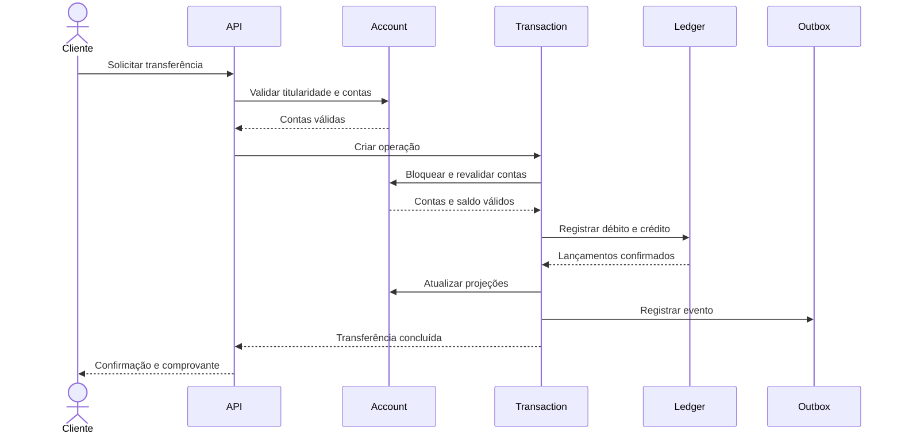
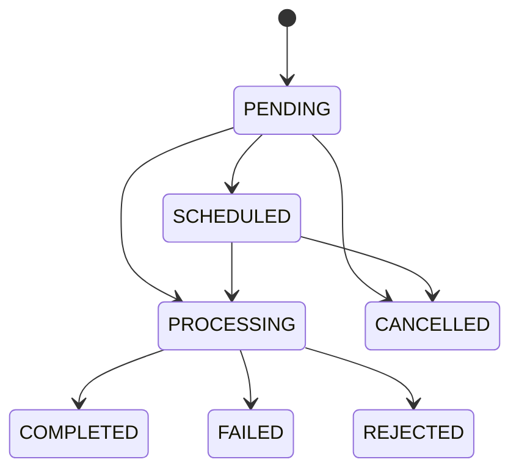

# MyBank — Fluxos Detalhados de Negócio

**Etapa:** Fluxos de negócio e diagramas de sequência  
**Versão:** 1.0 — Proposta para revisão  
**Status:** Aguardando aprovação  
**Base:** Contratos REST `/api/v1` aprovados

---

## 1. Objetivo

Definir o comportamento interno dos principais processos do MyBank, incluindo:

- Participantes e módulos envolvidos.
- Pré-condições e validações.
- Sequência de execução.
- Alterações de estado.
- Lançamentos financeiros.
- Tratamento de erros e concorrência.
- Idempotência e auditoria.
- Pós-condições e critérios de sucesso.

O backend é a autoridade para todas as operações financeiras. O frontend apenas solicita operações e apresenta seus resultados.

## 2. Princípios gerais dos fluxos

### 2.1 Consistência financeira

Toda operação que altera patrimônio deve:

1. Ser validada pelo domínio.
2. Executar dentro de uma transação ACID.
3. Registrar os lançamentos correspondentes no Ledger.
4. Garantir partidas dobradas: total de débitos igual ao total de créditos.
5. Atualizar a projeção de saldo na mesma transação.
6. Registrar o histórico de estados.
7. Garantir idempotência.
8. Registrar auditoria quando aplicável.

O Ledger é a fonte oficial do saldo. A projeção armazenada na conta serve para consultas eficientes e deve permanecer consistente com os lançamentos.

### 2.2 Concorrência

- Bloquear os registros financeiros necessários durante operações críticas.
- Adotar ordem determinística de bloqueio para reduzir deadlocks.
- Revalidar saldo, estado e limites dentro da transação.
- Não confiar em validações feitas anteriormente pelo frontend.
- Utilizar controle de concorrência para evitar decisões baseadas em dados desatualizados.

### 2.3 Idempotência

Operações financeiras que possam ser repetidas pelo cliente devem aceitar uma chave de idempotência.

- A mesma chave e o mesmo conteúdo devem retornar o resultado original.
- A mesma chave com conteúdo diferente deve ser rejeitada.
- Requisições concorrentes com a mesma chave não podem produzir duplicidade.
- O registro de idempotência deve ser persistido de forma consistente com a operação.

### 2.4 Falhas

- Falhas anteriores à contabilização não podem gerar lançamentos financeiros.
- Falhas durante uma transação devem provocar rollback.
- Operações já contabilizadas não podem ser simplesmente apagadas ou reabertas.
- Correções financeiras devem ocorrer por estorno ou compensação.
- Falhas em notificações não devem desfazer operações financeiras concluídas.

---

# 3. Transferências internas

## 3.1 Objetivo

Permitir transferências entre contas MyBank, sem integração com instituições externas.

## 3.2 Participantes

- Cliente autenticado.
- Identity.
- Account.
- Transaction.
- Ledger.
- Notification.
- Audit.

## 3.3 Pré-condições

- Cliente autenticado e ativo.
- Cliente é titular ativo da conta de origem.
- Conta de origem está ativa e habilitada para movimentação.
- Conta de destino existe e está ativa.
- Valor maior que zero.
- Saldo suficiente no momento da execução.
- Autenticação adicional concluída quando exigida pela política de risco.

## 3.4 Fluxo principal

1. Cliente informa a conta de destino, o valor e a descrição.
2. Frontend solicita a validação do destinatário.
3. Backend verifica a existência e a situação da conta de destino.
4. Backend retorna os dados permitidos para identificação do destinatário.
5. Cliente confirma a operação.
6. Frontend envia a solicitação com a chave de idempotência.
7. Backend autentica o usuário e valida sua titularidade.
8. Política de risco determina se é necessária autenticação adicional.
9. Backend valida os dados e a situação das contas.
10. Operação é registrada e passa para `PROCESSING`.
11. Backend bloqueia as contas de origem e destino em ordem determinística.
12. Saldo e estados são revalidados.
13. Backend cria os lançamentos contábeis correspondentes.
14. Débito e crédito são registrados no Ledger.
15. Projeções de saldo são atualizadas atomicamente.
16. Transação passa para `COMPLETED`.
17. Histórico e auditoria são registrados.
18. Evento de notificação é publicado pela Outbox.
19. Cliente recebe a confirmação e o identificador da operação.

## 3.5 Tratamento de falhas

| Situação | Comportamento |
|---|---|
| Saldo insuficiente | Rejeitar operação sem contabilização |
| Conta de origem bloqueada | Rejeitar operação |
| Conta de destino encerrada | Rejeitar operação |
| Destinatário inexistente | Retornar erro sem revelar informações indevidas |
| Falha antes da contabilização | Rollback |
| Falha durante contabilização | Rollback integral |
| Requisição repetida | Retornar resultado idempotente |
| Falha de notificação | Manter transferência concluída e registrar tentativa |

Uma operação que já tenha sido contabilizada não pode ser marcada como falha apenas porque a notificação não foi entregue.

## 3.6 Diagrama de sequência

## 3.7 Critérios de aceite

- Não permitir saldo negativo.
- Não permitir transferências duplicadas.
- Garantir débito e crédito equivalentes.
- Garantir consistência entre Ledger e projeção.
- Identificar o titular que iniciou a operação.
- Permitir consulta posterior do comprovante.
- Não permitir alteração direta de lançamentos contabilizados.

---

# 4. Depósitos e saques simulados

## 4.1 Objetivo

Simular entradas e retiradas de dinheiro utilizando contas contábeis de compensação, sem integração bancária externa.

## 4.2 Depósito

### Fluxo principal

1. Cliente solicita depósito.
2. Backend verifica autenticação, titularidade e situação da conta.
3. Valor e demais dados são validados.
4. Operação é registrada como `PENDING`.
5. Operação passa para `PROCESSING`.
6. Backend bloqueia a conta e revalida suas condições.
7. Ledger registra:
   - Débito na conta contábil de compensação de depósitos.
   - Crédito na conta contábil da conta bancária do cliente.
8. Projeção de saldo é atualizada.
9. Operação passa para `COMPLETED`.
10. Histórico, auditoria e evento de notificação são registrados.

## 4.3 Saque

### Fluxo principal

1. Cliente solicita saque.
2. Backend verifica autenticação, titularidade e situação da conta.
3. Valor é validado.
4. Operação é registrada como `PENDING`.
5. Operação passa para `PROCESSING`.
6. Backend bloqueia a conta e revalida o saldo.
7. Ledger registra:
   - Débito na conta contábil da conta bancária do cliente.
   - Crédito na conta contábil de compensação de saques.
8. Projeção de saldo é atualizada.
9. Operação passa para `COMPLETED`.
10. Histórico, auditoria e notificação são registrados.

## 4.4 Regras específicas

- Não existe integração com caixas eletrônicos ou instituições financeiras.
- Depósitos e saques representam operações simuladas.
- Cada operação deve possuir identificador próprio.
- O saque deve respeitar o saldo disponível no momento da execução.
- Repetições devem ser controladas por idempotência.
- Falhas não podem deixar lançamentos parciais.
- Operações contabilizadas não podem ser excluídas.

## 4.5 Critérios de aceite

- Depósitos aumentam o saldo.
- Saques reduzem o saldo.
- As contrapartidas contábeis são registradas corretamente.
- Não há criação de dinheiro sem contrapartida.
- Não há saque com saldo insuficiente.
- Todas as operações podem ser rastreadas.

---

# 5. Pagamentos de serviços fictícios

## 5.1 Objetivo

Permitir pagamentos simulados de serviços como água, energia, internet, telefonia, gás e outros serviços cadastrados.

Não haverá liquidação real de boletos, PIX ou cobranças externas.

## 5.2 Participantes

- Cliente.
- Payment.
- Account.
- Transaction.
- Ledger.
- Notification.
- Audit.

## 5.3 Fluxo principal

1. Cliente consulta os serviços disponíveis.
2. Seleciona o serviço.
3. Informa os dados exigidos pelo serviço fictício.
4. Backend valida o serviço e os dados.
5. Cliente informa valor e data, quando aplicável.
6. Backend valida os parâmetros.
7. Pagamento é criado como `PENDING`.
8. Se for agendado, passa para `SCHEDULED`.
9. Se for imediato, passa para `PROCESSING`.
10. No processamento, backend bloqueia a conta e revalida saldo e estado.
11. Ledger registra:
    - Débito na conta bancária do cliente.
    - Crédito na conta contábil correspondente ao serviço.
12. Projeção de saldo é atualizada.
13. Pagamento passa para `COMPLETED`.
14. Histórico, auditoria e notificação são registrados.

## 5.4 Agendamento

- Pagamentos agendados não reservam saldo.
- A data de execução é armazenada.
- No processamento, saldo e estado são novamente validados.
- Se não houver saldo suficiente, o pagamento pode passar para `FAILED`.
- O cliente pode cancelar enquanto estiver em `PENDING` ou `SCHEDULED`.
- Após entrar em `PROCESSING`, o cancelamento não é garantido.

## 5.5 Máquina de estados

## 5.6 Falhas

- Serviço inexistente ou inativo: rejeitar.
- Dados inválidos: rejeitar antes do processamento.
- Saldo insuficiente: falhar sem contabilização.
- Falha na contabilização: rollback.
- Cancelamento após processamento iniciado: não garantir cancelamento.
- Requisição repetida: aplicar idempotência.

## 5.7 Critérios de aceite

- Pagamentos não representam liquidação externa.
- Agendamentos não reservam saldo.
- Saldo é revalidado no processamento.
- Cancelamentos respeitam os estados permitidos.
- Todo pagamento concluído possui lançamentos no Ledger.

---

# 6. Empréstimos

## 6.1 Objetivo

Permitir simulação, solicitação, análise, aprovação, contratação e pagamento de empréstimos fictícios.

O cálculo utiliza o sistema Price, com juros e parâmetros configuráveis.

## 6.2 Participantes

- Cliente.
- Loan.
- Customer.
- Admin.
- Account.
- Transaction.
- Ledger.
- Notification.
- Audit.

## 6.3 Simulação

1. Cliente informa valor solicitado e prazo.
2. Backend consulta os parâmetros vigentes.
3. Backend calcula parcelas pelo sistema Price.
4. Backend apresenta taxa, valor das parcelas, total estimado e condições.
5. Simulação não cria obrigação financeira nem altera saldo.

A simulação é informativa. As condições definitivas dependem da análise e aprovação.

## 6.4 Solicitação

1. Cliente envia solicitação.
2. Backend valida situação cadastral.
3. Backend verifica empréstimos ativos e parcelas existentes.
4. Backend consulta renda declarada.
5. Backend calcula comprometimento de renda.
6. Backend verifica os limites configuráveis.
7. Solicitação é criada como `REQUESTED`.
8. Histórico e auditoria são registrados.
9. Cliente recebe confirmação.

## 6.5 Análise e aprovação

1. Administrador consulta solicitações pendentes.
2. Solicitação passa para `UNDER_REVIEW`.
3. Backend apresenta os dados necessários à análise.
4. Administrador decide aprovar ou rejeitar.
5. A decisão exige justificativa.
6. Se rejeitada, passa para `REJECTED`.
7. Se aprovada, passa para `APPROVED`.
8. Condições aprovadas são armazenadas como snapshot.
9. A oferta aprovada recebe prazo de validade (`expires_at`).
10. Cliente é notificado.

A análise deve considerar a concorrência: duas solicitações não podem ser aprovadas simultaneamente com base em uma capacidade de pagamento desatualizada.

## 6.6 Contratação

1. Cliente consulta a oferta aprovada.
2. Backend verifica validade e condições.
3. Cliente aceita as condições.
4. Backend bloqueia os registros necessários para garantir consistência.
5. Condições do contrato são persistidas.
6. Empréstimo passa para `CONTRACTED`.
7. Desembolso é executado atomicamente.
8. Ledger registra:
   - Débito na conta contábil de disponibilização de empréstimos.
   - Crédito na conta bancária do cliente.
9. Projeção de saldo é atualizada.
10. Empréstimo passa para `ACTIVE`.
11. Parcelas são geradas.
12. Histórico, auditoria e notificação são registrados.

Se o desembolso falhar, a contratação e a contabilização devem ser revertidas integralmente.

## 6.7 Parcelas

Estados:

- `PENDING`: parcela ainda não vencida.
- `PAID`: parcela quitada.
- `OVERDUE`: parcela vencida e não paga.
- `CANCELLED`: parcela cancelada por motivo permitido.

Transição permitida:

`OVERDUE -> PAID`

O pagamento de uma parcela deve registrar os lançamentos contábeis correspondentes e atualizar sua situação atomicamente.

## 6.8 Quitação

- O sistema calcula o valor de quitação conforme as regras configuradas.
- A quitação deve considerar parcelas pagas e obrigações restantes.
- Após a liquidação integral, o empréstimo passa para `PAID_OFF`.
- O contrato e seu histórico permanecem preservados.

## 6.9 Critérios de aceite

- Utilizar exclusivamente BigDecimal para valores monetários.
- Preservar as condições aprovadas no contrato.
- Não permitir contratação de oferta expirada.
- Não permitir desembolso duplicado.
- Controlar comprometimento de renda sob concorrência.
- Garantir consistência entre contrato, parcelas, transação e Ledger.
- Não cancelar diretamente empréstimos ativos.

---

# 7. Cartões virtuais

## 7.1 Objetivo

Permitir a criação e utilização de cartões virtuais fictícios com limite de gasto.

O limite não representa crédito concedido. Compras simuladas debitam imediatamente o saldo bancário do cliente.

## 7.2 Criação

1. Cliente solicita cartão virtual.
2. Backend verifica titularidade e situação da conta.
3. Backend valida os parâmetros permitidos.
4. Cartão é criado como `ACTIVE`.
5. Limite de gasto é registrado.
6. Projeção do limite disponível é inicializada.
7. Auditoria e notificação são registradas.

## 7.3 Compra simulada

1. Cliente solicita uma compra fictícia.
2. Backend verifica se o cartão está `ACTIVE`.
3. Backend valida titularidade e conta vinculada.
4. Backend verifica o limite disponível.
5. Backend bloqueia os registros necessários.
6. Saldo bancário e limite são revalidados.
7. Backend registra a transação.
8. Ledger registra:
   - Débito na conta bancária do cliente.
   - Crédito na conta contábil de compensação de compras simuladas.
9. Projeção de saldo é atualizada.
10. Limite consumido é atualizado.
11. Compra é registrada como concluída.
12. Auditoria e notificação são registradas.

## 7.4 Estorno

1. Cliente ou administrador autorizado solicita estorno conforme as regras.
2. Backend verifica a compra original.
3. Verifica se ela pode ser estornada.
4. Garante que não existe estorno duplicado.
5. Registra lançamentos inversos no Ledger.
6. Recompõe o saldo bancário.
7. Recompõe o limite disponível.
8. Registra o histórico do estorno.
9. Registra auditoria e notificação.

## 7.5 Estados

- `ACTIVE`: cartão habilitado.
- `BLOCKED`: cartão temporariamente bloqueado.
- `CANCELLED`: cartão cancelado definitivamente.

Um cartão bloqueado pode ser reativado. Um cartão cancelado não pode ser reativado.

## 7.6 Critérios de aceite

- O limite não representa crédito.
- Compras exigem saldo e limite suficientes.
- Compras debitam o saldo bancário imediatamente.
- Estornos recompõem saldo e limite.
- Compras e estornos são idempotentes.
- Cartões cancelados não podem realizar compras.

---

# 8. Contas conjuntas e encerramento

## 8.1 Objetivo

Definir os fluxos de participação, saída voluntária e encerramento de contas individuais e conjuntas.

## 8.2 Convite de titular

1. Titular ativo solicita convite.
2. Backend verifica sua participação na conta.
3. Backend verifica se o destinatário está cadastrado.
4. Backend verifica se o destinatário já participa de outra conta ativa.
5. Convite é criado como `PENDING`.
6. Prazo de validade é registrado.
7. Destinatário recebe notificação.
8. Destinatário autenticado consulta o convite.
9. Ao aceitar, backend revalida todas as condições.
10. Participação é registrada.
11. Convite passa para `ACCEPTED`.
12. Histórico e auditoria são registrados.

Convites podem ser cancelados pelo titular que os criou, conforme as regras definidas. Convites expirados passam para `EXPIRED`.

## 8.3 Saída voluntária

1. Titular solicita saída.
2. Backend verifica sua participação ativa.
3. Backend verifica se a saída respeita o mínimo de titulares.
4. Backend verifica as condições de encerramento e eventuais operações pendentes.
5. Se permitida, participação é encerrada.
6. Histórico e auditoria são registrados.

Não é permitido remover unilateralmente outro titular.

## 8.4 Encerramento da conta

1. Titulares solicitam encerramento.
2. Backend verifica o consentimento de todos os titulares ativos.
3. Backend verifica saldo igual a zero.
4. Backend verifica inexistência de operações pendentes.
5. Backend verifica cartões vinculados e exige bloqueio ou cancelamento.
6. Backend verifica condições contratuais e obrigações relacionadas.
7. Conta é bloqueada para novas operações.
8. Conta passa para `CLOSED`.
9. Histórico e auditoria são preservados.

Empréstimos são obrigações pessoais e continuam existindo após o encerramento da conta. A forma de pagamento simulada deve estar definida para evitar que a obrigação fique sem mecanismo de liquidação.

## 8.5 Participações percentuais

- Percentuais são opcionais.
- Quando definidos para todos os titulares, devem totalizar 100%.
- Sem percentuais definidos, o patrimônio permanece compartilhado e não é atribuído individualmente.
- O filtro de extrato por titular não modifica a contabilidade.

## 8.6 Critérios de aceite

- Nenhum cliente participa de duas contas ativas.
- Convites só podem ser aceitos pelo destinatário autenticado.
- Encerramento conjunto exige consentimento de todos.
- Conta com saldo positivo não pode ser encerrada.
- Operações pendentes impedem encerramento.
- Histórico financeiro permanece preservado.

---

# 9. Autenticação, sessões e segurança

## 9.1 Login

1. Usuário informa credenciais.
2. Backend valida os dados.
3. Backend verifica a situação do usuário.
4. Backend verifica se há exigência de 2FA.
5. Se não houver exigência, autenticação é concluída.
6. Se houver exigência, é criado desafio de autenticação.
7. Após validação do segundo fator, autenticação é concluída.
8. Backend emite Access Token e Refresh Token.
9. Sessão é registrada.
10. Histórico de acesso é atualizado.

Para administradores, o 2FA é obrigatório e deve ser configurado no primeiro acesso antes da entrada no painel administrativo.

## 9.2 Tokens

### Access Token

- JWT.
- Validade inicial proposta de 10 minutos.
- Armazenado em memória no frontend.
- Não armazenado em localStorage ou sessionStorage.
- Payload mínimo.
- Validação de assinatura, emissor, audiência e expiração.

### Refresh Token

- Validade inicial proposta de 7 dias.
- Armazenado como hash no banco.
- Entregue em cookie HttpOnly, Secure e SameSite.
- Rotação a cada renovação.
- Revogação no logout.
- Detecção de reutilização de token revogado.

## 9.3 Renovação de sessão

1. Frontend identifica expiração ou necessidade de renovação.
2. Envia solicitação usando o cookie de Refresh Token.
3. Backend valida token, sessão e situação do usuário.
4. Backend invalida o token anterior.
5. Emite novo Access Token e Refresh Token.
6. Persiste o novo hash.
7. Atualiza o cookie.
8. Retorna o novo Access Token.

Se um token antigo for reutilizado após rotação, o backend deve aplicar a política de segurança de revogação da sessão ou da família de tokens.

## 9.4 Logout

1. Cliente solicita logout.
2. Backend identifica a sessão.
3. Refresh Token é revogado.
4. Cookie é invalidado.
5. Evento de auditoria é registrado.
6. Frontend descarta o Access Token da memória.

## 9.5 2FA TOTP

- CUSTOMER pode habilitar ou desabilitar o 2FA.
- ADMIN deve manter 2FA habilitado.
- Segredo TOTP é armazenado criptografado.
- Códigos de recuperação são armazenados como hash.
- Código de recuperação é de uso único.
- Operações sensíveis podem exigir 2FA conforme política de risco.
- Alterações de segurança exigem reautenticação.
- ADMIN não pode desabilitar o próprio 2FA.

## 9.6 Desafio demonstrativo em desenvolvimento

- Código de seis dígitos gerado pelo backend.
- Validade proposta de dois minutos.
- Uso único.
- Limite de tentativas.
- Novo código invalida o anterior.
- Código armazenado como hash.
- Exibição restrita ao ambiente de desenvolvimento.
- Não representa envio real de SMS.

## 9.7 Critérios de aceite

- Tokens inválidos, expirados ou revogados são rejeitados.
- Refresh Token sofre rotação.
- Sessões podem ser revogadas.
- ADMIN não acessa o painel sem configurar 2FA.
- Segredos e tokens não aparecem em logs.
- Tentativas excessivas são limitadas.
- A autorização é validada no backend em todos os endpoints protegidos.

---

# 10. Notificações e Outbox

## 10.1 Princípio

Eventos secundários, como notificações, são processados de forma assíncrona por meio de Transactional Outbox no PostgreSQL.

A operação financeira não depende da entrega da notificação.

## 10.2 Fluxo

1. Caso de uso conclui uma operação.
2. Evento é gravado na Outbox dentro da mesma transação.
3. Processo de leitura identifica eventos pendentes.
4. Evento é processado pelo módulo responsável.
5. Notificação é criada.
6. Entrega é registrada por canal.
7. Falhas podem gerar novas tentativas limitadas.
8. Eventos definitivamente não processados são registrados para análise.

## 10.3 Regras

- Eventos possuem identificador único.
- Consumidores devem ser idempotentes.
- Notificações duplicadas devem ser evitadas.
- Erros de entrega devem ser rastreáveis.
- Conteúdo não pode expor tokens, senhas ou dados financeiros desnecessários.
- Email é simulado no ambiente de desenvolvimento.
- Push depende da permissão concedida pelo usuário.

---

# 11. Auditoria e rastreabilidade

Devem gerar registros de auditoria, conforme aplicabilidade:

- Login, logout e falhas de autenticação relevantes.
- Alterações de senha e 2FA.
- Criação e revogação de sessões.
- Transferências, depósitos, saques e pagamentos.
- Solicitações, aprovações e rejeições de empréstimos.
- Compras e estornos de cartões.
- Convites, saídas e encerramentos de contas.
- Bloqueios e desbloqueios.
- Alterações administrativas.
- Consultas a dados sensíveis.

Cada registro deve conter, quando aplicável:

- Identificador do evento.
- Usuário responsável.
- Ação executada.
- Recurso afetado.
- Data e hora.
- Resultado.
- Justificativa, quando obrigatória.
- Identificador de correlação da requisição.

Não registrar senhas, tokens, segredos TOTP ou dados completos de cartão.

Logs técnicos e auditoria de negócio devem permanecer separados.

---

# 12. Regras transversais

| Regra | Aplicação |
|---|---|
| Idempotência | Operações financeiras e comandos que possam ser repetidos |
| ACID | Operações que alteram Ledger ou estado financeiro |
| Partidas dobradas | Todos os movimentos contábeis |
| Concorrência | Saldo, limites, contratos e participações |
| Autorização | Backend em cada recurso e endpoint |
| Auditoria | Ações sensíveis e administrativas |
| Outbox | Notificações e eventos secundários |
| Estorno | Correção de operações contabilizadas |
| Histórico | Preservação das transições de estado |
| LGPD | Retenção, anonimização e atendimento de solicitações |

# 13. Testes obrigatórios

## 13.1 Testes unitários

- Regras de domínio.
- Máquinas de estados.
- Cálculo Price.
- Validação de saldo.
- Limites de cartões.
- Regras de encerramento.
- Idempotência.
- Autorização por titularidade.

## 13.2 Testes de integração

- Persistência de transações.
- Consistência Ledger e projeções.
- Rollback.
- Outbox.
- Refresh Token.
- TOTP.
- Convites e participações.
- Pagamentos agendados.
- Contratação e desembolso de empréstimos.

## 13.3 Testes de concorrência

- Duas transferências simultâneas usando o mesmo saldo.
- Duas compras simultâneas usando o mesmo limite.
- Solicitações de empréstimo concorrentes.
- Aceitação simultânea de convites.
- Requisições repetidas com a mesma chave de idempotência.
- Tentativas concorrentes de encerramento.

## 13.4 Testes de segurança

- Acesso a conta de outro cliente.
- Escalada de CUSTOMER para ADMIN.
- Manipulação de identificadores.
- Reutilização de Refresh Token.
- Bypass de 2FA.
- Acesso a operações sem titularidade.
- Ações administrativas sem justificativa.
- Consultas sensíveis sem autorização.
- CSRF e XSS.

# 14. Decisões que ainda precisam de definição

Os fluxos respeitam as decisões já aprovadas. Entretanto, alguns parâmetros operacionais ainda precisam ser definidos antes da implementação:

1. **Limites financeiros:** valores máximos e mínimos por operação, configuráveis por tipo de operação e política de risco.
2. **Taxas de empréstimo:** valores iniciais e limites permitidos para configuração.
3. **Prazo das ofertas de empréstimo:** duração da aprovação antes de expirar.
4. **Pagamento de parcelas:** mecanismo simulado, datas de vencimento e tratamento de atraso.
5. **Estornos:** prazos, condições e limites para estorno de compras e operações.
6. **Agendamentos:** frequência do processamento e política de tentativas.
7. **Política de risco:** critérios que exigem 2FA adicional.
8. **Contas conjuntas:** tratamento operacional de obrigações pessoais quando o titular encerra sua participação.

Esses parâmetros não devem ser inventados durante a implementação. Devem ser definidos e documentados antes da etapa correspondente.

# 15. Critérios gerais de aceite da etapa

- Todos os sete fluxos principais estão documentados.
- Cada fluxo possui pré-condições, sequência e pós-condições.
- Máquinas de estados respeitam as transições aprovadas.
- Lançamentos financeiros respeitam partidas dobradas.
- Falhas e concorrência possuem tratamento definido.
- Idempotência está prevista.
- Auditoria e Outbox estão contempladas.
- Os contratos REST aprovados são respeitados.
- Testes necessários estão identificados.
- Pendências estão explicitadas, sem decisões arbitrárias.

# 16. Próxima etapa sugerida

Após a aprovação dos fluxos, a próxima etapa será revisar os parâmetros operacionais pendentes e consolidar as decisões em ADRs e documentação técnica.

Somente depois do fechamento dessas definições será adequado preparar o prompt mestre definitivo para o Codex.

**Status final:** proposta apresentada para revisão. Nenhuma implementação autorizada nesta etapa.

# Complemento aprovado — reprocessamento administrativo da Outbox

1. ADMIN autenticado com 2FA solicita reautenticação vinculada a `OUTBOX_EVENT_REPROCESSING`.
2. A interface envia o identificador do evento, a justificativa, a confirmação adicional e a chave de idempotência ao endpoint documentado.
3. O backend verifica autorização, reautenticação, justificativa, confirmação, estado elegível, ausência de execução incompatível e idempotência.
4. A solicitação e o ator são auditados; as tentativas anteriores e o payload original permanecem preservados.
5. Uma solicitação aceita retorna `202 Accepted` e `statusUrl`; o frontend consulta o recurso até obter o estado de processamento disponível.
6. A política de estado terminal permanece pendente de harmonização entre `FAILED` e `DEAD_LETTER`.
